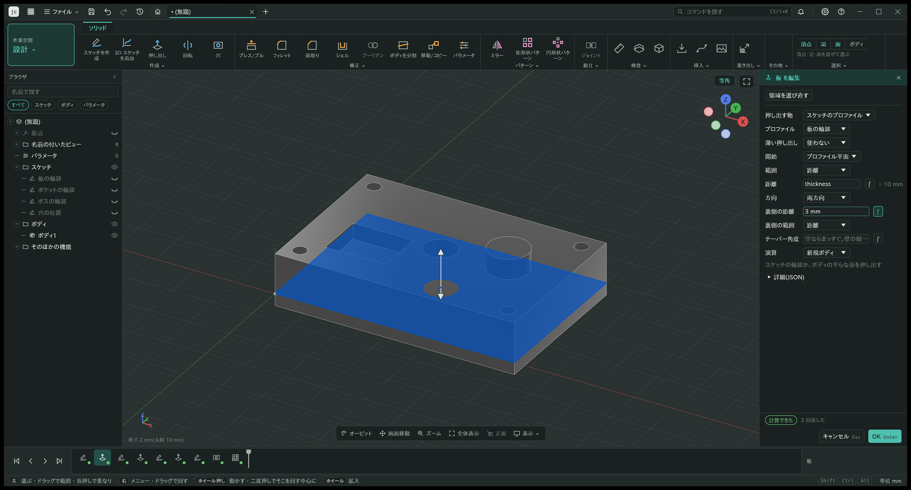
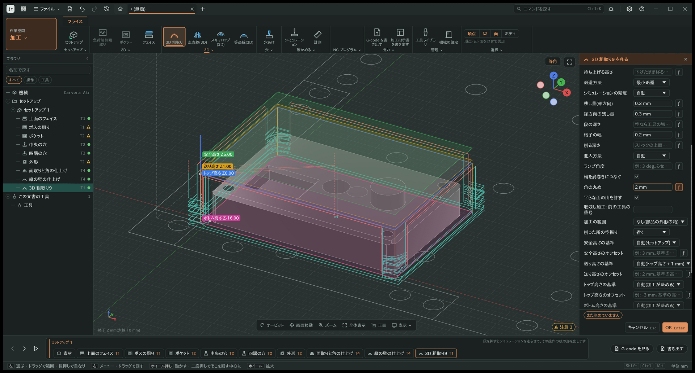

<h1 align="center">kieMonoBench</h1>

<p align="center">
  <strong>A parametric 3D CAD and CAM application in Rust that takes the model you design straight to machining.</strong><br />
  Sketch with constraints and dimensions, build solids, and create toolpaths on the same timeline. Change a dimension
  and both the model and its toolpaths are rebuilt. The desktop app, the command line (CLI) and AI agents (MCP) all run the same operations.
</p>

<p align="center">
  <a href="README.md">日本語</a> · English
</p>



*The Design workspace: a tabbed toolbar per workspace at the top, the browser on the left, the timeline at the bottom and the edit panel on the right. Here the extrusion of the sample plate is being edited: setting the direction to both sides and typing the back distance previews the new shape in blue. The user interface is currently in Japanese only.*



*The Machining workspace: operations made from the design model are listed in the setup tree on the left. Linking the 3D roughing passes into a spiral and rounding its corners regenerates the toolpath, shown with the clearance, retract, top and bottom heights.*

This is work in progress and there are no prebuilt downloads yet. Build it from source.

The desktop app is `kie-monobench`, the CLI is `kmb` and the MCP server is `kmb-mcp` (the crates are still `jc-cli` and `jc-mcp`). Documents use the `.kmb` extension (the content is JSON). On first start, the data folder of the earlier working name (`jisaku-cadcam`) is carried over, and `.json` documents still open.

## What it does

- **Sketches:** lines, rectangles, circles, arcs, slots, polygons, ellipses, splines, conics and text, fixed with constraints and dimensions. Dimensions can be parameter expressions. 3D sketches and canvas images are supported too.
- **Solid features:** extrude, revolve, holes and threads, sweep, loft, fillet, chamfer, shell, boolean, split body, move/copy, offset faces, patterns and mirror, all on an editable timeline.
- **Parameters and configurations:** unit-aware expressions (mm, in and more), parameter tables, and a configuration table that switches between sets of values.
- **Assemblies:** components, joints, rigid groups, motion studies, contact sets, interference checks, standard fasteners, bills of materials, and linked parts from other files.
- **Machining (CAM):** setups (stock, origin, fixtures), 2D operations (adaptive clearing, pocket, face, contour, slot, engrave, V-carve, chamfer, thread milling, drilling), 3D operations (3D roughing, raster, waterline, scallop, pencil, spiral, radial and more) and laser. Multiple tools per job, including rest machining with a smaller tool.
- **Verification:** stock removal simulation (gouges, leftover material, shank and holder collisions), re-reading the written G-code and cutting it again, and setup sheets (Markdown and HTML).
- **Rendering and animation:** appearances, lights and decals, still images and turntable videos, exploded views and joint motion videos.
- **Analysis:** structural and thermal, flow and aerodynamics.
- **Files and versions:** designs are local JSON files and nothing needs the network. Every save keeps a version you can compare with and restore.
- **App, CLI and MCP:** one set of operation declarations and checks behind all three. The list of operations and tools is in [docs/入出力.md](docs/入出力.md) (generated from the registry, in Japanese).

## Machines and file formats

| Kind | Supported |
|---|---|
| Machines (G-code posts) | Carvera Air (default), generic 3-axis (Fanuc-style and Grbl-style), SCULPFUN G20 (galvo laser). Post processors can also be added as WASM plugins |
| Import | STEP, DXF, SVG, images (canvas) |
| Export | STEP, STL, 3MF, glTF (.glb), DXF and SVG of the current view, PNG and video, G-code, setup sheets, BOM as CSV |
| Design files | JSON (older format versions are migrated one step at a time; files from a newer version are refused rather than misread) |

The machining core is machine-independent; the differences between machines live in the machine library and the posts.

## Building

Requirements:

- Rust (the version is pinned in `rust-toolchain.toml`; rustup installs it automatically)
- A C++17 compiler (MSVC from Visual Studio 2022 on Windows, g++ on Linux) to build the SMLib geometry kernel in `third_party/usd-brep`. CMake is not needed. The first build takes 3 to 8 minutes on 4 cores
- On Linux, the windowing and graphics libraries for the desktop app (X11 or Wayland, and a Vulkan driver)

```sh
cargo run --release -p jc-app -- --sample   # open the app with the sample part and its machining
cargo run --release -p jc-app               # start from the start screen
cargo run --release -p jc-cli -- --help     # the command-line tool (kmb)
cargo xtask verify                          # tests and checks for the crates you changed
```

The default geometry kernel is SMLib. Set `JC_KERNEL=truck` to use truck instead. To build without SMLib, build the app with `--no-default-features` (truck only).
How to test and the logging rules are in [docs/verify.md](docs/verify.md) (in Japanese).

## Getting started

- **Desktop app:** started without arguments, it shows a start screen with samples and a getting-started walkthrough that goes from opening a sample to writing G-code. The usual workflow is described in [docs/使い方.md](docs/使い方.md) (in Japanese).
- **Command line (`kmb`):** create designs, change parameters, add features, export, write G-code and simulate. `kmb actions` lists the same operations as the app's buttons and `kmb run` runs them.

  ```sh
  kmb sample --cam cam.kmb        # a design with the sample part and its machining
  kmb param set cam.kmb width "60 mm"
  kmb gcode cam.kmb cam.nc        # G-code for the Carvera Air
  kmb sim cam.kmb                 # check for gouges and leftover material
  kmb export cam.kmb part.step
  ```

- **AI agents (MCP):** `kmb-mcp` is a Model Context Protocol server over standard input and output. It can only read and write the working folder (`--root`) and folders given with `--allow`. With "AI connection" turned on in the app's settings, it can also work on the document open in the running app.

  ```json
  { "mcpServers": { "kiemonobench": {
    "command": "<path to the repository>/target/release/kmb-mcp",
    "args": ["--root", "<folder the AI may read and write>"] } } }
  ```

  Moving from the earlier names (CLI `jc`, MCP server `jc-mcp`): change `command` in your MCP settings to `.../kmb-mcp` (`kmb-mcp.exe` on Windows), and replace `jc` with `kmb` in your scripts. The old executables are no longer built, so a `jc` or `jc-mcp` left in `target/release` stays out of date (you can delete it). The settings key (`kiemonobench` above) can stay. Log files now start with `kmb-cli-` and `kmb-mcp-`.

- **Post processor plugins:** WASM components (interface in `crates/jc-plugin-host/wit/post.wit`). Plugins get no access to files, the network or the clock. An example is in `plugins/post-example/`.

Before cutting on a real machine, always check in this order: simulation, an air cut with Z raised, then a test cut in wax or MDF.

## Contributing

See [CONTRIBUTING.en.md](CONTRIBUTING.en.md) for issues and pull requests, [SECURITY.md](SECURITY.md) for reporting vulnerabilities and [CODE_OF_CONDUCT.md](CODE_OF_CONDUCT.md) for conduct.

The design principles, structure, input/output contracts and the shared rules for the UI and for the work are in [AGENTS.md](AGENTS.md), with detailed rules per area in [.claude/rules/](.claude/rules/) and a map of the code in [docs/地図.md](docs/地図.md). The project documents are currently written in Japanese.

The rules are enforced by the checks in `cargo xtask verify`. No GPL, LGPL or AGPL dependencies or code. Code from other software is never copied. Patented interaction designs are not implemented ([docs/避ける形.md](docs/避ける形.md)).

## Licence

Licensed under either the MIT licence ([LICENSE-MIT](LICENSE-MIT)) or the Apache License 2.0 ([LICENSE-APACHE](LICENSE-APACHE)), at your option. Copyright is held by "kieMonoBench contributors". Bundled third-party software and data keep their own licences (below).

This software is developed independently and is not affiliated with any machine maker or CAD/CAM vendor. Names of machines, file formats and software are trademarks of their respective owners and are used only to describe compatibility.

### Bundled third-party software and data

- `third_party/usd-brep/`: SMLib and SM_API from NVIDIA usd-brep 1.0.0 (Apache-2.0, Copyright (c) 2020-2026 NVIDIA CORPORATION & AFFILIATES; full text in `third_party/usd-brep/LICENSE`).
- `third_party/smlibpy-patches/`: two SMLib fixes from smlibpy (Copyright (c) 2026 AWV Informatik AG, MIT; full text in `third_party/smlibpy-patches/LICENSE`). The STEP writer in `crates/jc-kernel-smlib/shim/jc_step.cpp` is also based on smlibpy's writer.
- `third_party/truck-shapeops/`: a patched copy of truck-shapeops 0.4.0 (Apache-2.0, Copyright (c) RICOS Co. Ltd.; full text in `third_party/truck-shapeops/LICENSE`), used for booleans in the alternative truck kernel.
- `futural.jhf` and `rowmans.jhf` in `crates/jc-text/fonts/`: Hershey font data. The Hershey Fonts were originally created by Dr. A. V. Hershey while working at the U. S. National Bureau of Standards. The format of the Font data in this distribution was originally created by James Hurt, Cognition, Inc. Full licence text in `crates/jc-text/fonts/HERSHEY-LICENSE.txt`.
- Origins and update procedures: [third_party/README.md](third_party/README.md) (in Japanese).
