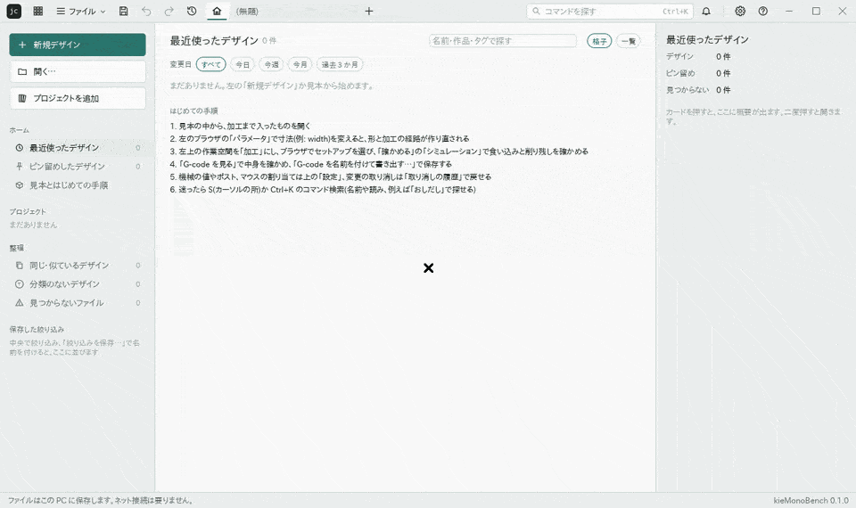

<h1 align="center">kieMonoBench</h1>

<p align="center">
  <strong>設計したモデルをそのまま加工へ回せる、Rust のパラメトリック 3D CAD・CAM。</strong><br />
  スケッチに拘束と寸法を付けて形を作り、同じタイムラインで加工の経路まで作る。寸法を変えると形も経路も作り直される。
  画面・コマンド(CLI)・AI(MCP)のどれからも同じ操作ができる。
</p>

<p align="center">
  日本語 · <a href="README.en.md">English</a>
</p>



*用例: 穴が 4 つある基板の取付け板。AI のエージェントが MCP の `app` の道具で画面を動かし、スケッチの寸法をパラメータの「幅」につなぎ、押し出し、加工の穴あけと輪郭まで作る。最後に幅を 80 mm から 110 mm に変えると、板も穴の位置も加工の経路も作り直される(2.2 倍速、最後だけ等倍)。*


*設計の作業空間。上に作業空間ごとのツールバー、左にブラウザ、下にタイムライン、右に編集パネル。見本の板の押し出しを開き、方向を「両方向」にして裏側の距離を打つと、変えた後の形が青く予告される。*


*加工の作業空間。左のセットアップの木に設計の形から作った加工が並ぶ。3D 粗取りの輪を渦巻きにつなぎ角を丸めると、経路が作り直され、安全高さ・送り高さ・トップ高さ・ボトム高さの札とともに出る。*

まだ開発の途中で、配布用の実行ファイルはない。ソースから組み立てて使う。

画面のアプリは `kie-monobench`、コマンドは `kmb`、MCP サーバは `kmb-mcp`(crate は今までどおり `kmb-cli`・`kmb-mcp`)。文書の拡張子は `.kmb`(中身は JSON)。前の仮の名前(`jisaku-cadcam`)の時のデータフォルダは最初の起動で引き継ぎ、`.json` の文書もそのまま開ける。

## 何ができるか

- **スケッチ**: 線分・長方形・円・円弧・長穴・多角形・楕円・スプライン・円錐曲線・文字。拘束と寸法で決め、寸法はパラメータの式で書ける。3D スケッチと下絵(キャンバス)もある。
- **形を作る**: 押し出し・回転・穴とねじ・スイープ・ロフト・フィレット・面取り・シェル・ブーリアン・ボディの分割・移動とコピー・面のオフセット・パターン・ミラー。すべてタイムラインに並び、あとから直せる。
- **パラメータと構成**: 単位つきの式(mm・in など)、パラメータの表、構成表(寸法の組を切り替える)。
- **組立**: 部品、ジョイント、剛性グループ、モーション スタディ、接触セット、干渉の確かめ、規格部品、部品表、ほかのファイルをリンクで挿入。
- **加工(CAM)**: セットアップ(ストック・原点・固定具)、2D の加工(負荷制御粗取り・ポケット・フェイス・輪郭・スロット・彫刻・V 彫り・面取り・ねじ切り・穴あけ)、3D の加工(3D 粗取り・走査線・等高線・スキャロップ・ペンシル・渦巻き・放射状ほか)、レーザー。複数の工具を使い、細い工具で残りを削る。
- **確かめる**: 削るシミュレーション(食い込み・削り残し・ホルダーの当たり)、書き出した G-code を読み直して削る確かめ、加工指示書(Markdown・HTML)。
- **レンダリングとアニメーション**: 外観・光源・デカール、静止画と回す動画、分解とジョイントの動きの動画。
- **解析**: 強度と熱、流れと空力。
- **ファイルと版**: 文書はローカルの JSON で、ネットを使わない。保存のたびに版が残り、前の版と見比べて戻せる。
- **画面・CLI・MCP**: 同じ操作の宣言と確かめを通る。操作と道具の一覧は [docs/入出力.md](docs/入出力.md)(登録から生成)。

## 対応する機械と形式

| 種類 | 対応 |
|---|---|
| 機械(G-code のポスト) | Carvera Air(既定)、汎用 3 軸(Fanuc 系・Grbl 系)、SCULPFUN G20(ガルバノのレーザー)。WASM のポストのプラグインも足せる |
| 読み込み | STEP、DXF、SVG、画像(下絵) |
| 書き出し | STEP、STL、3MF、glTF(.glb)、今の視点の DXF・SVG、PNG と動画、G-code、加工指示書、部品表の CSV |
| 文書 | JSON(版を 1 つずつ移して読む。新しい版の文書は読まずに止める) |

加工の核は機械に依存せず、機械ごとの違いはマシンライブラリとポストに閉じている。

## 組み立て

要る物:

- Rust(版は `rust-toolchain.toml` で決まり、rustup が自動で入れる)
- C++17 のコンパイラ(Windows は Visual Studio 2022 の MSVC、Linux は g++)。形状カーネル SMLib(`third_party/usd-brep`)を組み立てるため。CMake は要らない。初回は 4 コアで 3〜8 分かかる
- Linux で画面を動かすには、窓と描画の部品(X11 か Wayland、Vulkan のドライバ)

```sh
cargo run --release -p kmb-app -- --sample   # 見本の部品と加工で画面を開く
cargo run --release -p kmb-app               # 開始画面から始める
cargo run --release -p kmb-cli -- --help     # コマンド(kmb)の一覧
cargo xtask verify                          # 変えた crate のテストと点検
```

形状カーネルの既定は SMLib。環境変数 `JC_KERNEL=truck` で truck に替えられる。SMLib を入れずに組み立てる時は、アプリを `--no-default-features` で組み立てる(truck だけになる)。
検査の手順とログの決まりは [docs/verify.md](docs/verify.md)。

## 使い方の入口

- **画面**: 引数なしで起動すると開始画面が出て、見本と「はじめての手順」(見本を開いてから G-code を書き出すまで)がある。操作の流れは [docs/使い方.md](docs/使い方.md)。
- **コマンド(`kmb`)**: 文書を作る・パラメータを変える・機能を足す・書き出す・G-code を作る・削ってみる。画面のボタンと同じ操作は `kmb actions` で一覧し、`kmb run` で動かす。

  ```sh
  kmb sample --cam cam.kmb        # 見本の部品と加工の文書を作る
  kmb param set cam.kmb width "60 mm"
  kmb gcode cam.kmb cam.nc        # Carvera Air 向けの G-code
  kmb sim cam.kmb                 # 食い込みと削り残しを調べる
  kmb export cam.kmb part.step
  ```

- **AI(MCP)**: `kmb-mcp` は標準入出力で動く MCP サーバ。読み書きできるのは作業フォルダ(`--root`)と `--allow` のフォルダだけ。画面の設定で「AI との接続」を入れると、動いている画面の文書も操作できる。

  ```json
  { "mcpServers": { "kiemonobench": {
    "command": "<リポジトリの場所>/target/release/kmb-mcp",
    "args": ["--root", "<読み書きを許すフォルダ>"] } } }
  ```

  前の名前(コマンド `jc`、MCP の `kmb-mcp`)から移る時: MCP の設定の `command` を `.../kmb-mcp`(Windows は `kmb-mcp.exe`)に書き換え、台本などで `jc` と打っていた所を `kmb` にする。前の名前の実行ファイルはもう作られないので、`target/release` に残った `jc`・`kmb-mcp` は古いまま止まる(消してよい)。設定の鍵(上の `kiemonobench`)はそのままでよい。ログのファイルの頭は `kmb-cli-`・`kmb-mcp-` になる。

- **ポストのプラグイン**: WASM のコンポーネント(インタフェースは `crates/kmb-plugin-host/wit/post.wit`)。ファイル・ネットワーク・時計には触れられない。見本は `plugins/post-example/`。

実機で削る前に、必ずシミュレーション、Z を浮かせた空運転、ワックスや MDF での試し削りの順に確かめる。

## 開発に加わる

Issue と PR の出し方は [CONTRIBUTING.md](CONTRIBUTING.md)、脆弱性の知らせ方は [SECURITY.md](SECURITY.md)、振る舞いは [CODE_OF_CONDUCT.md](CODE_OF_CONDUCT.md)。

思想・構造・入出力の約束・見た目と作業の決まりは [AGENTS.md](AGENTS.md)、分野の細かい決まりは [.claude/rules/](.claude/rules/)、どこに何があるかは [docs/地図.md](docs/地図.md)。方針は [docs/policy.md](docs/policy.md)、段階と設計は [docs/plan.md](docs/plan.md)、画面の言葉は [docs/用語表.md](docs/用語表.md)、機能ごとの記録は [docs/機能/](docs/機能/)。

決まりは `cargo xtask verify` の点検で守る。GPL・LGPL・AGPL の依存とコードは使わない。ほかのソフトのコードは写さない。特許のある操作の形は作らない([docs/避ける形.md](docs/避ける形.md))。

## ライセンス

MIT([LICENSE-MIT](LICENSE-MIT))か Apache-2.0([LICENSE-APACHE](LICENSE-APACHE))の、使う人が選ぶ方。著作権者の表記は「kieMonoBench contributors」。同梱する他のソフトとデータは、それぞれの許諾に従う(下)。

このソフトは独立に作っており、機械や CAD・CAM の製品の作り手とは関係がない。機械・ファイル形式・ソフトの名前はそれぞれの持ち主の商標で、互換を示すためだけに書いている。

### 同梱する他のソフトとデータ

- `third_party/usd-brep/`: NVIDIA usd-brep 1.0.0 の SMLib と SM_API(Apache-2.0、Copyright (c) 2020-2026 NVIDIA CORPORATION & AFFILIATES。全文は `third_party/usd-brep/LICENSE`)。
- `third_party/smlibpy-patches/`: smlibpy(Copyright (c) 2026 AWV Informatik AG、MIT。全文は `third_party/smlibpy-patches/LICENSE`)の SMLib の修正 2 つ。`crates/kmb-kernel-smlib/shim/jc_step.cpp` の STEP の書き出しも smlibpy の書き出しを元にしている。
- `third_party/truck-shapeops/`: truck-shapeops 0.4.0(Apache-2.0、Copyright (c) RICOS Co. Ltd.。全文は `third_party/truck-shapeops/LICENSE`)を直した写し。予備の形状カーネル truck のブーリアンに当てる。
- `crates/kmb-text/fonts/` の `futural.jhf` と `rowmans.jhf`: Hershey フォントのデータ。The Hershey Fonts were originally created by Dr. A. V. Hershey while working at the U. S. National Bureau of Standards. The format of the Font data in this distribution was originally created by James Hurt, Cognition, Inc. 許諾の全文は `crates/kmb-text/fonts/HERSHEY-LICENSE.txt`。
- 出どころと更新の手順は [third_party/README.md](third_party/README.md)。
