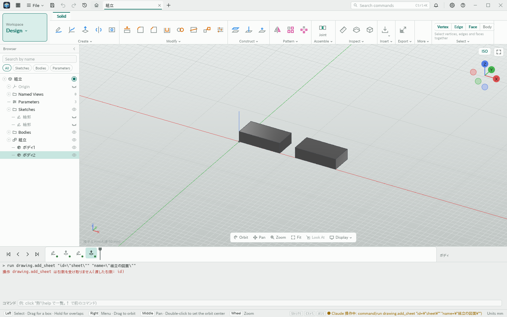
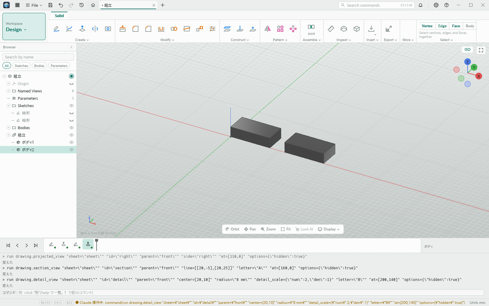
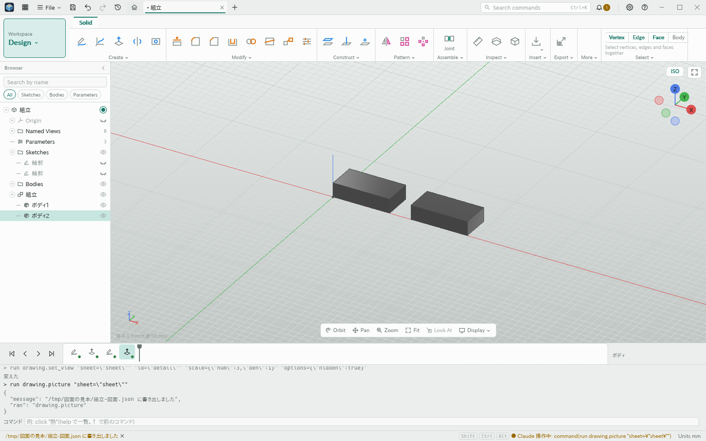
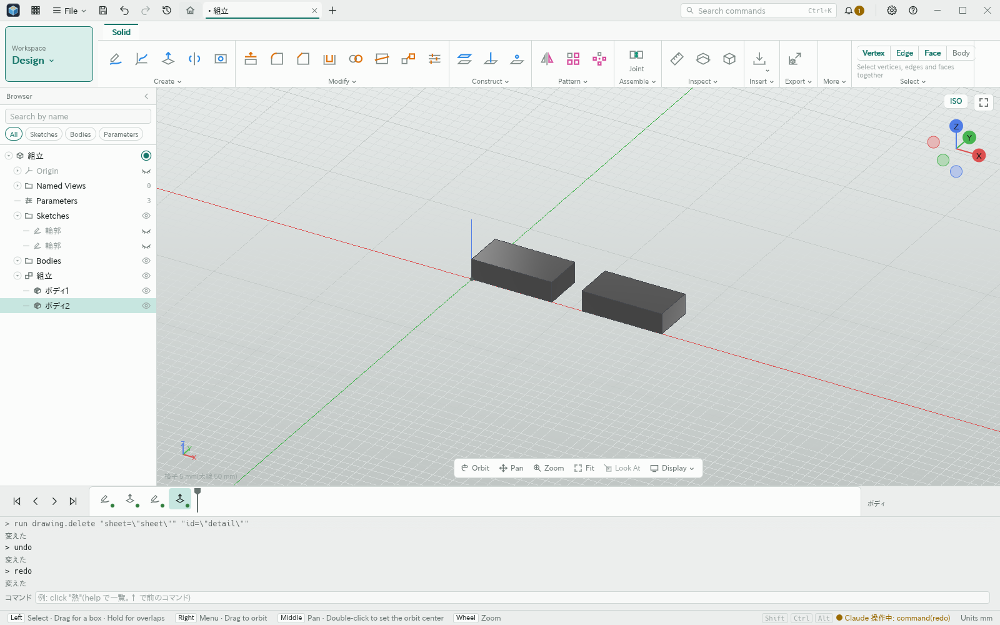
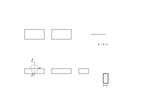
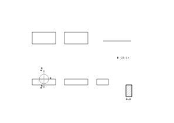

# 図面のビュー

- 日付: 2026-10-27

## 作った物

図面の用紙とビューを区画 `draw.sheets` の版 1 に保存する。
線は保存せず、最後まで再計算した形から毎回作る。
区画の変更は取り消しとやり直しに対応し、知らない項目を残す。

`kmb-drawing` は基準・投影・断面・詳細のビューを扱う。
基準ビューは名前の向きと面内の直角回転を持つ。
投影ビューは第一角法と第三角法に対応する。
投影・断面の位置は親からの距離で持ち、親の移動に付いてくる。
詳細ビューは親の線を円で切り、指定した尺度で拡大する。
断面の切り口はボディごとの閉じた輪で、用紙上 3 mm 間隔のハッチを出す。
切断線・矢印・文字と詳細の円も用紙の線に含む。

用紙は A0〜A4 と自由サイズ、横向きと縦向きを持つ。
太線・細線・極太線の既定は 0.5・0.25・1.0 mm とする。
外形・隠れ・接線の線種とペンを線ごとに持つ。
円の軸が見る向きに平行なら円弧を保つ。

`kmb-view-lines` は網の投影・曲面の輪郭・隠れを求める純関数を持つ。
視点の DXF・SVG も同じ計算を使う。
折れ線のまっすぐな区間だけを間引き、折り返す点は残す。
円を真横から見ても直径の長さを保つ。
`kmb-interchange::drawing` の計算結果は JSON で往復できる。
名前付きの辺と曲面の輪郭の表をビューごとに返す。
辺の名前を取れないボディは網の線を使い、寸法を付けられない警告を出す。
一つのビューが失敗しても他のビューを出す。
同じ形の線は端の向きと輪の開始点をそろえる。
用紙の座標は 1e-8 mm 単位に丸め、再計算しても同じ JSON を返す。

操作は `drawing.` の名前で登録する。
用紙の追加、四種類のビュー、移動、尺度と表示の編集、削除、線の JSON 書き出しを扱う。
書き出しは共通のファイル出力を通る。
見本は箱・穴のある箱・円柱・複数ボディの三面図と断面・詳細を持つ。

## 決めたこと

図面はタイムラインに載せない。
親参照のないビュー、親の輪、id の重複を区画の検査で断る。
参照切れを別の形に付け替えない。
閉じていない断面の切り口は誤りとする。
形の表示状態は図面の元のボディの選択に使わない。
画面、寸法と注記の中身、用紙の枠と表題欄は別の機能で扱う。

## 足した言葉

図面・用紙・基準ビュー・投影ビュー・断面ビュー・詳細ビュー・尺度・ハッチ・寸法・注記・引出線・中心の印・中心線・番号札・部品表・表題欄。

## 試し方

保存済みの形を開き、コマンド欄で `run drawing.add_sheet id=sheet name=図面` を実行する。
`run drawing.base_view sheet=sheet id=front orientation=front` で基準ビューを作る。
`run drawing.picture sheet=sheet` で文書の隣に線の JSON を書き出す。
投影・断面・詳細を追加し、親の移動、尺度の編集、削除と取り消し・やり直しを確かめる。

写真は同じ形を使った実アプリのコマンド欄の操作を示す。
比較用の版は id と name を持つ用紙の追加を拒否する。
図面操作では用紙とビューの定義を編集し、線の JSON を書き出す。

| 用紙の追加を拒否 | ビューを追加 |
|---|---|
|  |  |

| 線の JSON を書き出す | 削除の取り消しとやり直し |
|---|---|
|  |  |

次の図は書き出した JSON の線を別途可視化した物で、アプリの画面ではない。

| 移動と尺度の編集の前 | 親を移動し、詳細を拡大 |
|---|---|
|  |  |
