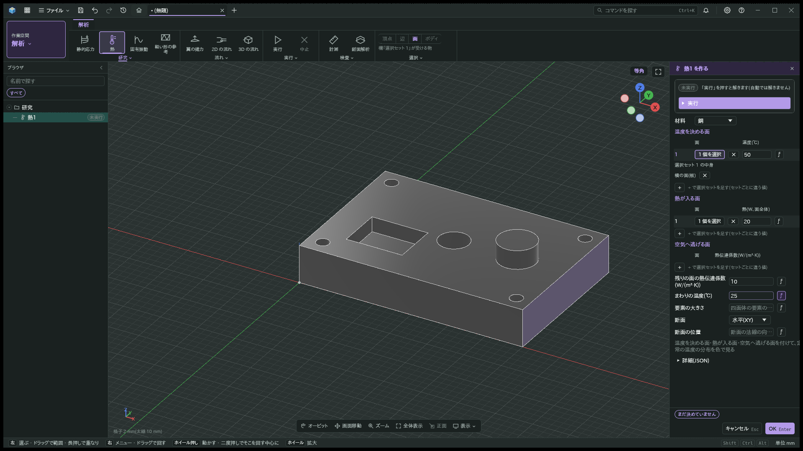
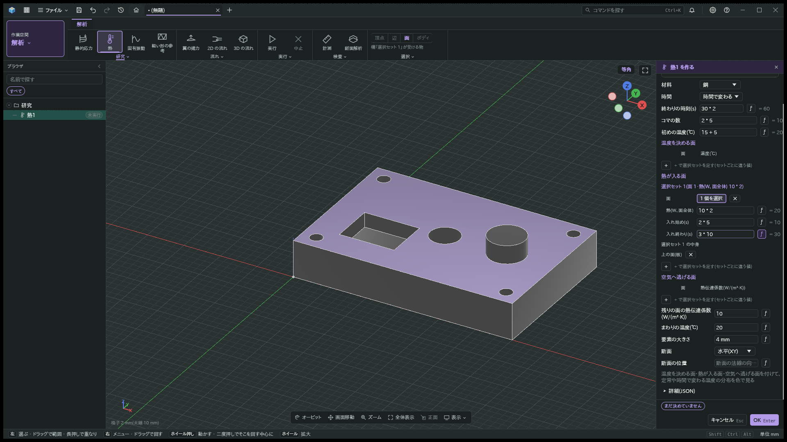
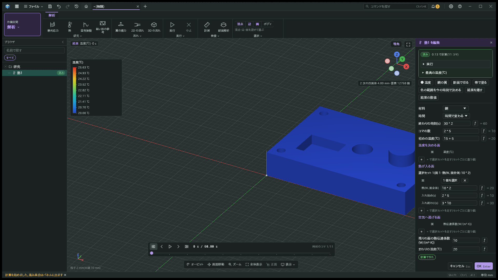
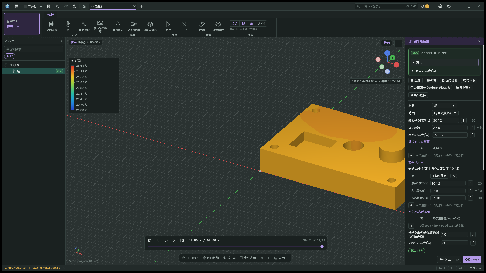
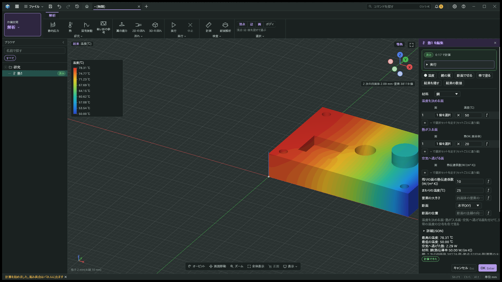
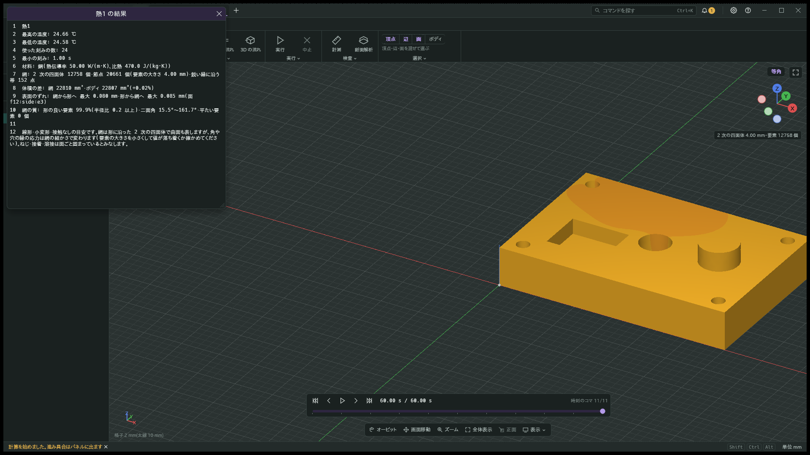

# 時間で変わる熱

- 日付: 2026-10-27

## 作った物

熱の研究 `fea.thermal@1` の「時間」で定常と時間で変わる計算を選べる。
時間で変わる時は終わりの時刻とコマの数、初めの温度を指定する。
コマの数は空なら 50、2 から 200 の整数で、時刻 0 のコマも加える。
熱の行の「入れ始め」と「入れ終わり」で加熱の区間を指定する。
同じ面に行を重ねると、時間ごとに加える熱を変えられる。

材料の比熱と密度から熱容量を求める。
結果は温度の時刻のコマと、最高の温度と空気へ逃げた熱の推移を持つ。
最高と最低の温度、使った刻みの数と最小の刻みも数値で示す。
中止すると、完成したコマを途中までの結果として残す。
コマや推移をまとめている間に中止が届いた時も、完成した結果を残す。

## 決めたこと

熱容量は 2 次の四面体の整合質量で組み立て、後退オイラー法で時間を進める。
連立方程式は代数的マルチグリッドを前処理にした共役勾配法で解く。
前の刻みの温度を初めの値にし、刻みが同じ間は行列と前処理を保持する。
節点の温度変化を目安に刻みを変え、コマと加熱の切り替えの時刻にはちょうど止める。
網の細かさで決まる下限でも変化が急な時は、計算を続けて注記を出す。
コマの間隔が下限より短い場合も、コマの時刻を優先して刻みを短くする。
加熱の切り替えまでの残り時間が下限より短い場合も、その時刻に止める。
これらの短い刻みで目安を超える変化があれば、同じ注記を出す。
全コマで共通の凡例を使う。

「時間」が空の文書は定常として解く。
定常では熱の行の時刻や過渡専用の欄を読まず、定常の温度を保つ。
熱の行の時刻の列は時間で変わる時だけ出し、定常の熱量と面の欄は横に並ぶ。

## 試し方

熱の研究で「時間で変わる」を選び、終わりの時刻と初めの温度を入れて実行する。
既存の再生の帯で各時刻の温度を比べる。
集中熱容量の冷却、長い棒の局所温度、定常への収束、刻みを半分にした誤差を軽い試験で照合する。

## 画面

同じ見本の部品を、1920×1080、暗い画面、倍率 1 で描く。
定常の例と時間で変わる例では、境界条件と要素の大きさが違う。
写真は欄と時刻の見せ方を比べる物で、両例の温度の一致を示す物ではない。

| 定常の欄 | 時間で変わる欄 |
|---|---|
|  |  |

| 時刻 0 s | 時刻 60 s |
|---|---|
|  |  |

全コマで凡例は 20.00〜25.63 ℃の同じ範囲になる。
最後の温度の最大値は 24.66 ℃、最小値は 24.58 ℃で、凡例の最大値は途中の加熱中に達する温度を含む。

