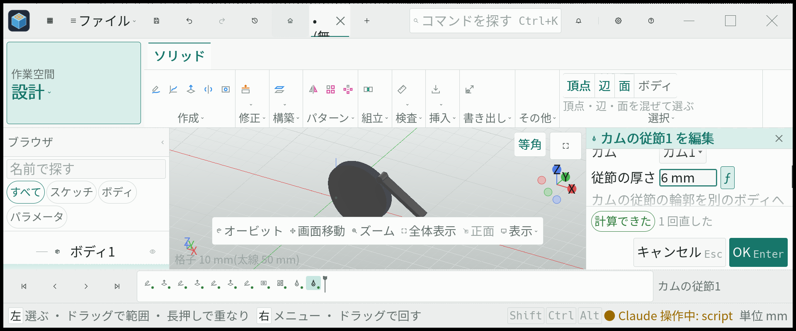
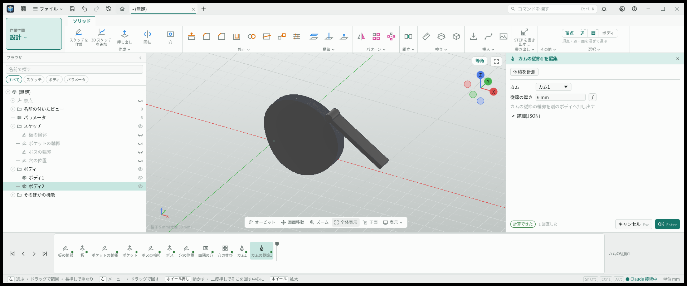
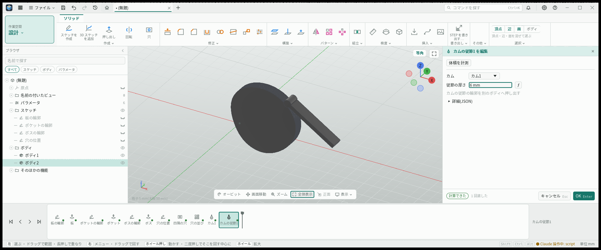

# カムと従節

- 日付: 2026-11-04
- 統合・省略欄の修理: 2026-11-09

## 作った物

操作「カム」(`mech.cam`)で平面と中心を選ぶと、カム `mech.cam@1` と従節 `mech.cam_follower@1` を同じ取り消し単位で足す。それぞれ独立したボディを持ち、厚さを別々に直せる。画面・CLI・MCP は一つの引数宣言を通る。機構の種類と操作は歯車のモジュール内で登録する。

変位の線図は「上がり 120 deg 10 mm サイクロイド, 止まり 60 deg, 下がり 120 deg 単弦, 止まり 60 deg」のように書く。数と単位の間に空白を置く。数の所は空白を含まない式も受ける。直動の変位は mm、揺動の変位は deg で指定する。区間の角の和を 360 deg、一周後の変位を 0 にする。下がりの変位を省くと、その区間の始まりの変位から 0 へ戻る。

ナイフは先の軌跡、ローラーはその中心の軌跡を半径だけ内側へずらした輪郭、平らな先は動く直線の包絡線を使う。歯車と共通の二円弧の近似で閉じた輪郭を作る。直動のローラーで圧力角が 30 deg を超える所と、曲率の半径より太いローラーには注意を出す。既存の `CamSpec` に一度ごとの変位を 360 区間で渡す。

## 決めたこと

- 運動の法則は等速・単弦・サイクロイド・3-4-5 の四つ。単弦・サイクロイド・3-4-5 は上がりと下がりの両端で速度が 0 になる。等速は区間内の速度を一定に保ち、両端も 0 にしない。止まりとの境目で速度が変わることを注意する。サイクロイドは両端の加速度も 0 になる。
- 揺動の支点までの距離を `CamSpec::arm` に入れ、軸の基準の向きで支点の方向を示す。支点と腕の長さで基礎円に先を置けなければ入力の誤りにする。
- ローラーの半径・ずれ・腕の長さ・支点 x・支点 y は空欄で省略でき、それぞれ 2 mm・0 mm・30 mm・40 mm・0 mm を使う。欄の説明にも省略時の寸法を出す。明示した単位つきの式は式として保持する。
- 適用しない種類の寸法は保存しない。直動と揺動、ナイフとローラーを切り替えて欄を再び表示した時は、残っていない値に省略時の寸法を使う。
- 専用のカム操作に作成を一本化し、機能の種類には作成時の既定データを宣言する。既存のピンが使う機能の操作 ID からも専用のカム操作へ移行する。

## 試し方

設計の「作成」から「カム」を押し、平面と中心を選ぶ。基礎円の半径と変位の線図を指定する。従節の種類と先の形を選び、揺動では腕の長さと支点を指定する。カムと従節が別のボディとして表示されることを確かめる。両方の厚さの既定値は 5 mm で、従節側だけ 6 mm に変えられる。

数値を入力してから五つの省略できる欄を空に戻し、計算が続くことと省略時の寸法の説明を確認する。種類を往復させた後も同じ省略時の寸法を使う。新しい欄名と省略時の説明は日本語・英語を用意する。選択値名は既存の宣言を引き継ぐ。

画面の検査は通常の MCP の道具からクリック・入力・スクロールする。四法則、揺動、従節の厚さ、五つの欄の省略と種類の往復、日本語・英語の省略説明を確認する。公開前の暗明画像と、1920 幅・字の倍率 250 % の確認は、それぞれ実行した版の記録として区別する。

## 省略欄の修理と画面確認

五つの任意寸法欄を空に戻しても計算を続けられるようにし、日本語・英語の省略時の寸法説明を加えた。欄名と省略説明は英語でも確認し、選択肢の値名と注意本文は従来の表示を保持する。

四法則・揺動・五つの空欄と切替・日英説明は `30d90693` の通常 MCP で確認した。最新統合 `1dbaf96e` では私的 Cam の幾何・法則・既定値・文字列が同じであることを照合し、1920 幅の明色で通常 MCP から厚さを入力した。250 % で従節の厚さを 5 mm から 6 mm に変え、100 % に戻して両ボディの全体を確認した。

写真は面 `f15:f8:side:e5`、軸 Y 負方向の揺動従節であり、旧原点 XY 平面の直動例とは配置と種類が異なる。字250%では中央の操作帯が形状下部に重なるため、全体は100%の写真を使う。画像は無加工で、形式変換前後の全画素を照合した。

通常 MCP の入力元を確認した CPU ハーネスの検査であり、外側の JSON-RPC、実 OS の窓、GPU の描画は未検査。以前のスクリプト経路の記録を通常 MCP の成功に数えていない。
