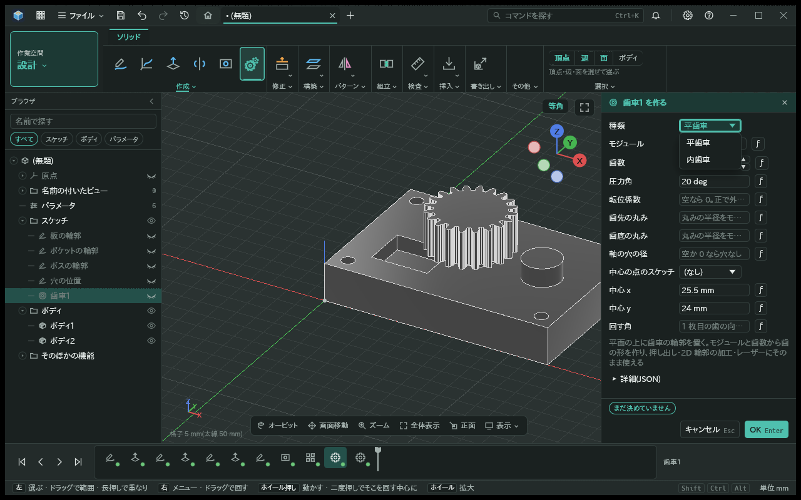
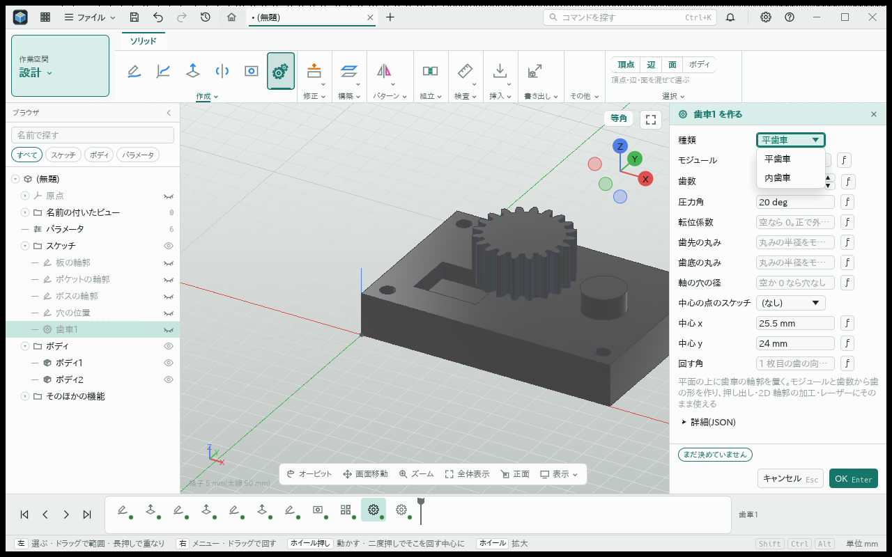
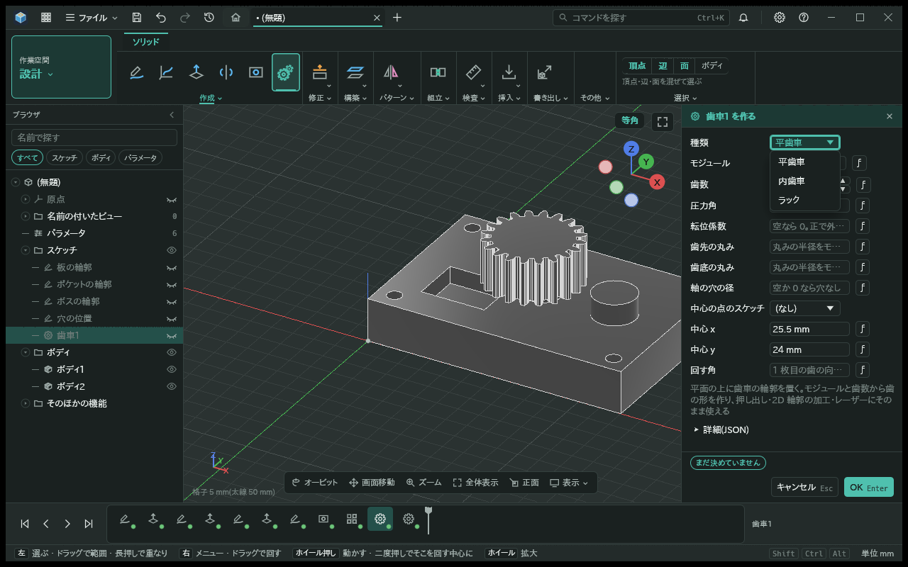
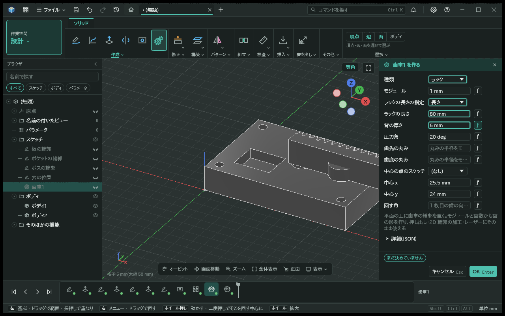
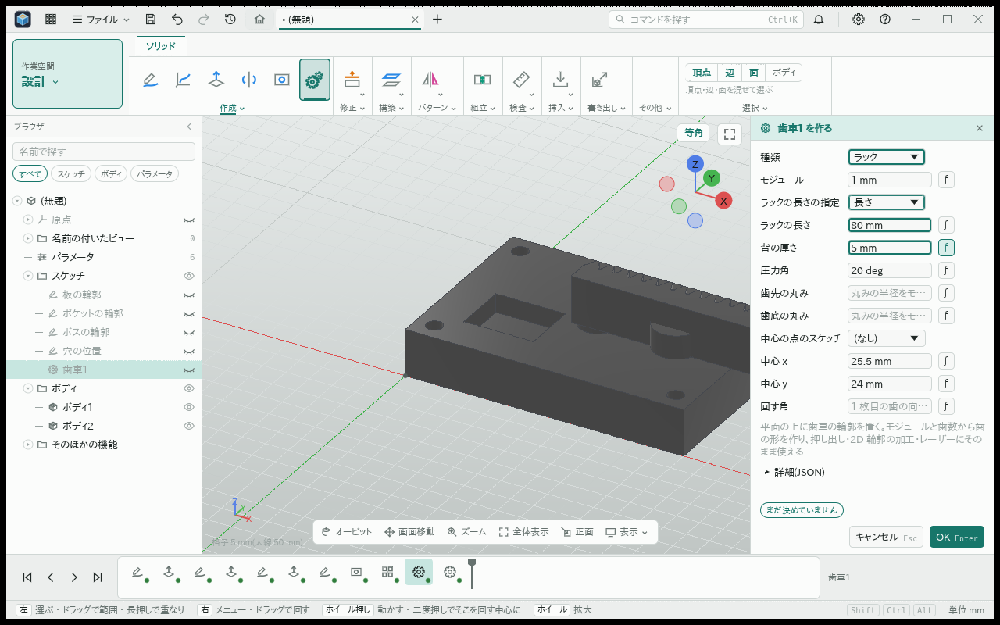
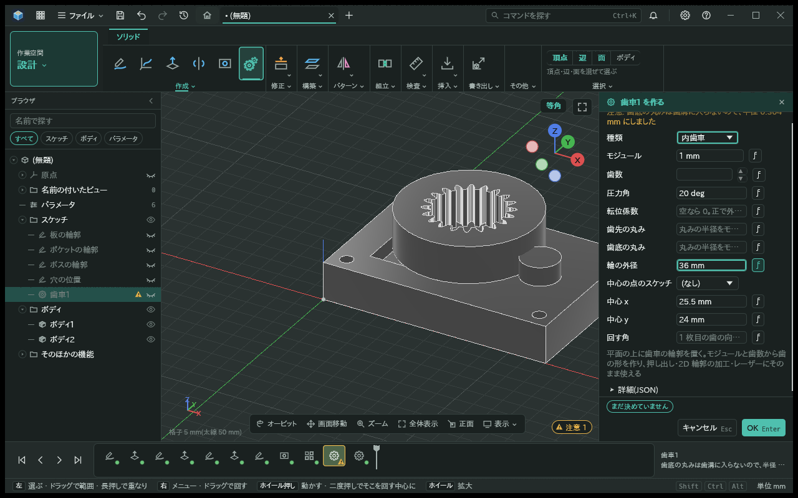
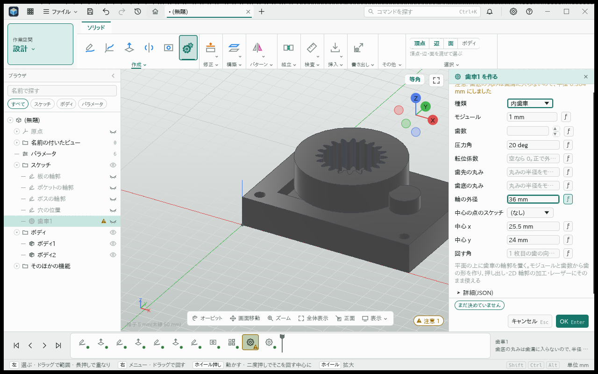
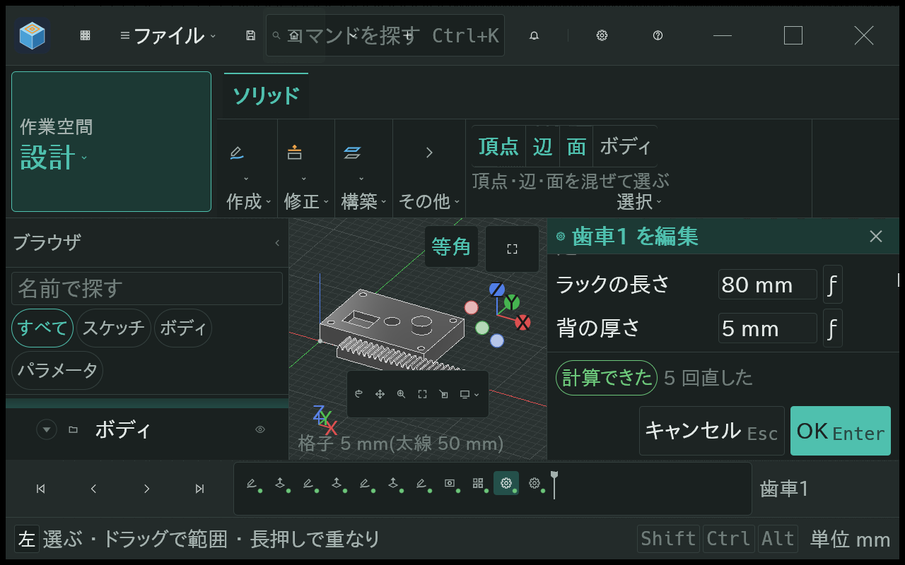
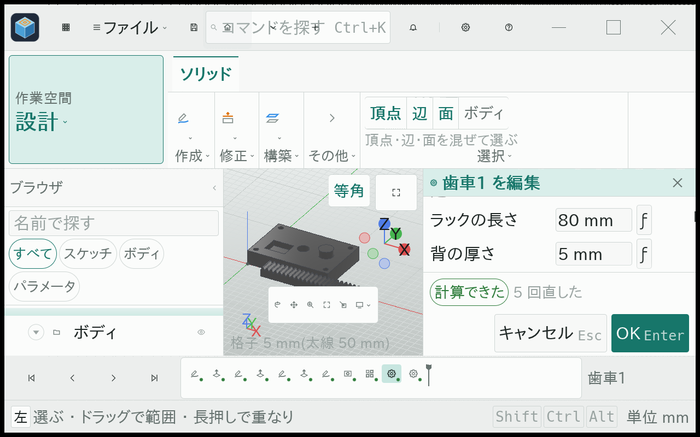

# ラックの輪郭とボディ

- 日付: 2026-11-04

## 作った物

- 歯車の輪郭の種類「ラック」。ピッチ線の始点は既存の中心の欄で置き、回す角で X 方向を回す。スケッチの点と平面も同じ入口を使う。
- モジュール・圧力角・歯先と歯底の丸み、長さの指定方法、全長、背の厚さを使う。長さの指定は歯数か長さを選ぶ。歯数なら円ピッチ × 歯数、長さなら完全な歯が入る個数を並べ、余りは歯底の高さの背として残す。長さ指定時には使わない歯数欄を隠す。歯数は個数の式と同じく 1〜1000 枚に限る。
- 背の厚さは歯底から背までで、空ならモジュールの 2 倍。歯面は直線、丸みは接線円弧。大きい丸みは隣接する直線の長さから縮め、注意を出す。歯溝を作れない圧力角や不正な厚さは入力の誤りにする。
- ピッチ線を参照の線として出し、輪郭は一つの閉じた領域として出す。諸元の種類はラック、ピッチ円半径は 0、歯数は実際に並べた個数。ピッチ線始点と平面の X 方向・回す角を既存の軸と位相で表す。
- 歯車のボディはこの輪郭を既存の歯の幅だけ押し出す。ラックに軸の穴と転位は使わず、指定があれば理由を出して止める。歯車との比はこの変更では作らない。
- 操作「歯車」「歯車の輪郭」もラック、長さの指定、背の厚さ、回す角を受け、同じ機能のデータを作る。ラックのモジュール・長さ・背の厚さは入力した数の精度を保つ。

## 土台に合わせたこと

- 輪郭の土台は参照の円を持つため、同じ crate 内で参照の直線を持てるようにした。諸元の保存形式やコアの API は変えない。
- 圧力角はピッチ線の法線と歯面の角として扱う。歯面の傾きは tan(圧力角)、ピッチ線上の歯厚は π × モジュール / 2、歯先はモジュール、歯底は −1.25 × モジュール。
- SMLib のボディ試験は、カーネルを直に使う既存の歯車試験のある kmb-solid に最小追加する。

## 確かめ方

- 純関数で歯数と長さ・歯厚・高さ・閉鎖・自己交差・区間名・面積・誤りを確認する。
- 操作から作った輪郭で、回したピッチ線と諸元の始点・向き・実歯数を確認する。
- 12 歯のラックで、ボディの体積が輪郭面積 × 歯の幅と一致することを確かめる。

## 直し 1: 新しい土台との統合

最新 main `e8b3857` を通常のマージで取り込み、確認したソースは `bbf8f9d`。平歯車・内歯車・ラックの 3 種類を残し、ラックの長さ指定から内歯車、ラック、平歯車へ戻して、それぞれに必要な欄が出ることを確認した。内歯車の歯先・歯底の向き、外径と薄い輪の検証、既存の保存形式と試験は残す。欄の条件は共通の種類選択に従い、内歯車の参照の直線は空にする。

以下の「前」は新土台 main `1b8658a` の種類一覧で、今回の最新 main の画像とは区別する。「後」は上記 `bbf8f9d` で採った実画面。以前の画像も履歴のため残す。

| 場面 | 暗色 | 明色 |
| --- | --- | --- |
| 前: 新土台の平歯車・内歯車 |  |  |
| 後: 3 種類の一覧 |  |  |
| 後: ラックを長さ 80 mm・背の厚さ 5 mm で指定 |  |  |
| 後: 長さ指定から内歯車へ切替 |  |  |
| 後: 文字 250% のラック欄（スクロール後） |  |  |

実画面は幅 1280 / 1920、高さ 800、文字 100% / 250%、暗色 / 明色の 8 条件で確認した。100% では 3 種類の往復、250% では種類一覧、スクロール後のラックのラベルと値、確定ボタンへの到達を確認した。250% で平歯車へ戻す際の歯数 12 は操作台本の入力・値の検査で確認しており、最後の画像では注意文により歯数欄が画面外となる。全ツールバーボタンの網羅確認は含めない。

英語を含む土台の共通表示は取り込んだ main の範囲であり、今回の直しで翻訳や新機能を増やしてはいない。検査の実ログ・原画像・実行ファイルの版と SHA は作業証拠側に保存し、旧版の合格を最新版の合格として扱わない。
