# ローラーチェーンの鎖車

- 日付: 2026-11-04

## 作った物

- 歯車の輪郭 `cad.gear@1` の種類「鎖車」を作る。鎖の呼びは25・35・40・50・60・80から選び、手入力ではピッチ・ローラーの径・鎖の内幅を指定する。呼び35はブシュチェーンの寸法を使う。
- 呼びの表はJIS B 1801の値を持つ。ピッチ円・歯先円・歯底円、ローラーの座、側面の円弧は歯数と鎖の寸法から決まる。座の角と半径、側面の半径、歯先径は規格の最小値と最大値の中間を使う。
- 座と側面は接する円弧でつなぐ。歯先は歯先円の円弧で閉じる。区間の名前は歯ごとの `t<i>:root`・`t<i>:r0`・`t<i>:tip`・`t<i>:l0` を使う。
- 出力 `gear` の種類は鎖車、モジュールは0、鎖のピッチを `chain_pitch` に入れる。鎖や動きの連動は作らない。
- 歯車のボディの「歯の幅」は空欄なら自動で決まる。鎖のピッチが12.7 mm以下では内幅の0.93倍、それより大きい時は0.95倍を使う。他の歯車の空欄は10 mmとし、保存済みの明示値はそのまま使う。

## 決めたこと

- 歯底円の参照はピッチ径からローラー径を引いた呼び寸法を使う。座にはローラーの逃げがあるため、その最深部は参照の歯底円より内側になる。軸の穴は実際の座に重ならない径まで指定できる。
- 自動の歯幅は長さの出力 `default_width` で輪郭からボディへ渡す。ボディは空欄の時だけその出力に依存する。

## 足した言葉

「鎖の呼び」「鎖のピッチ」「ローラーの径」「鎖の内幅」を使う。

## 試し方

「歯車」を置き、種類を「鎖車」に変える。鎖の呼び40と歯数17を選び、ボディの歯幅を空欄にすると7.3935 mmになる。手入力では鎖の3寸法をすべて指定する。

形の純関数は寸法と輪郭の閉じ方を確かめる。ボディの試験は既存の立体試験の配置で、体積と自動幅、平歯車の未指定幅の互換を確かめる。

## 種類と部位を合わせた確認

- 平歯車・内歯車・ラック・鎖車の種類、欄と操作を同時に残す。内歯車の歯付き穴、ラックの長さ指定、平歯車の穴・ボス・キー溝と部位ごとの厚さを保つ。
- 鎖車は軸の穴を含む輪郭全体をrimとして渡し、平歯車のrim・腕・ボスの分割と区別する。鎖車の歯幅を省いた時は鎖内幅由来の値、他の種類を省いた時は10 mm、明示値は入力値を使う。
- 呼び35の補足と手入力の選択値、一部の注意には日本語が残る。規格の表の数値を独立に照合したとの主張はしない。

以下の直し前は、保存された旧鎖車の実画面(平歯車・鎖車の2種類)であり、新しいmainを撮り直した物ではない。統合後は4種類を使う同じ作業場の新しい実画面で確かめる。元の機能追加前の画像も保持する。

| 確認 | 暗い画面 | 明るい画面 |
|---|---|---|
| 直し前の2種類 |  |  |
| 統合後の4種類 | 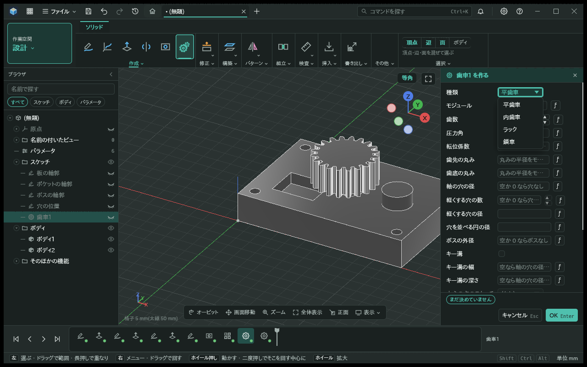 | 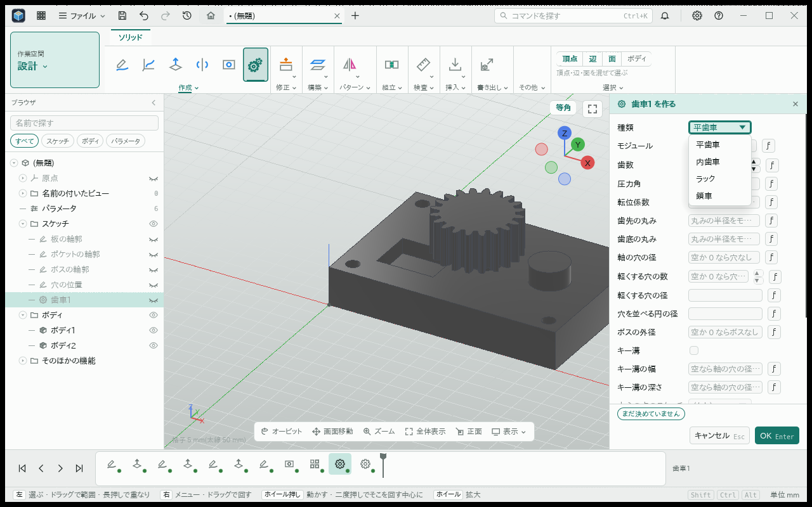 |
| 直し前の自動幅 | 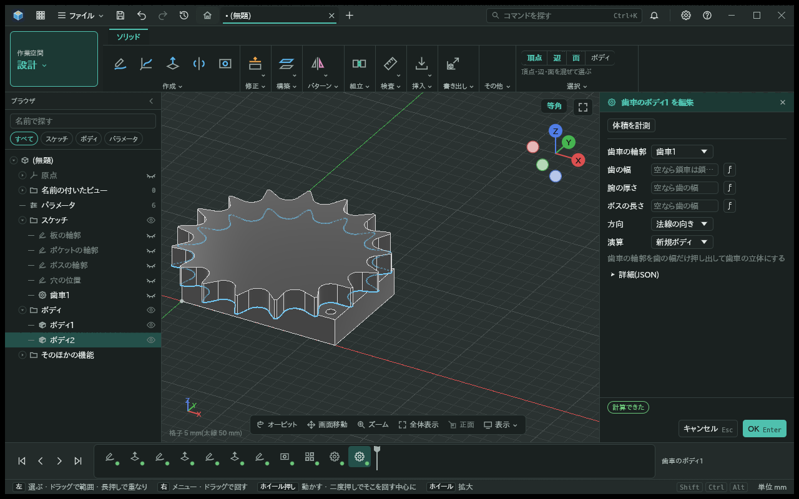 | 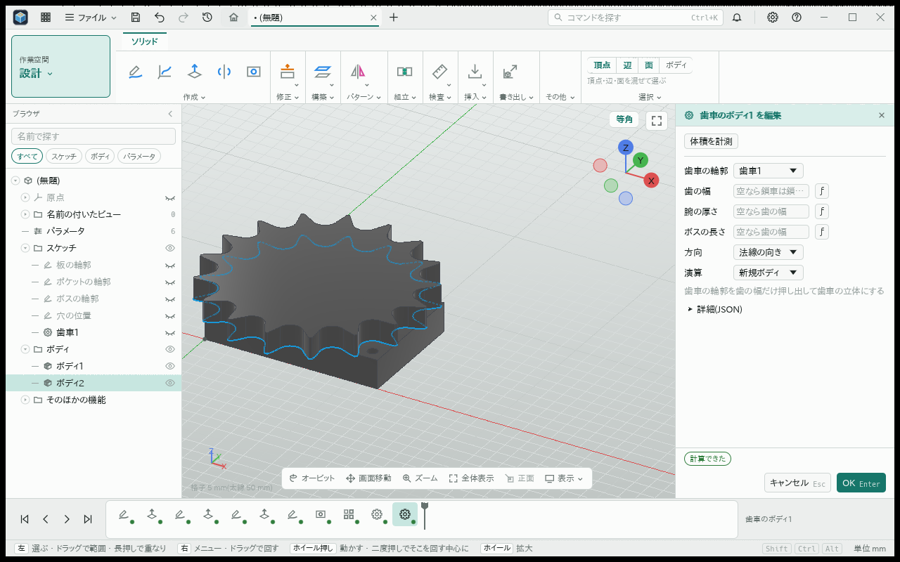 |
| 統合後の幅5 mm | 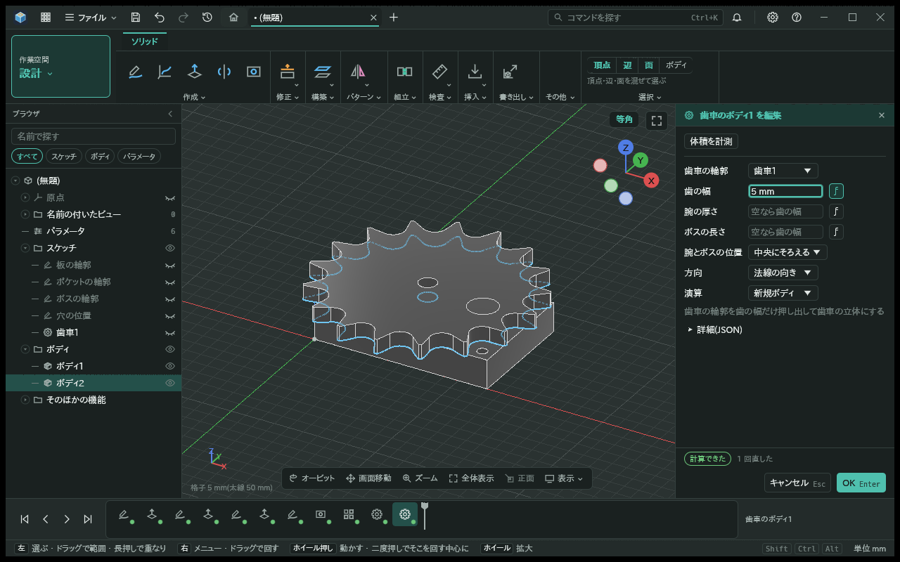 | 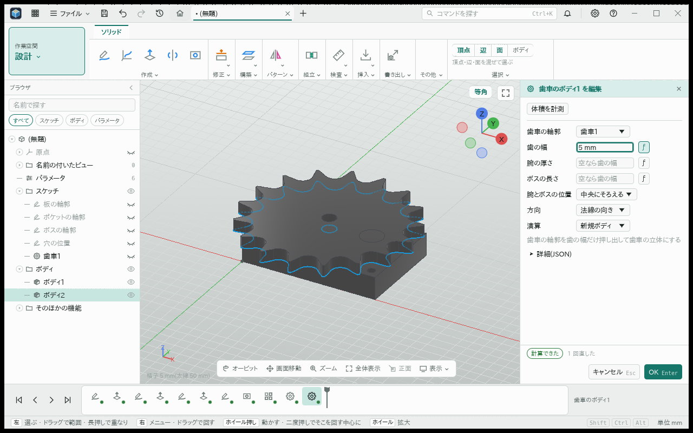 |
| 字250%の手入力 | 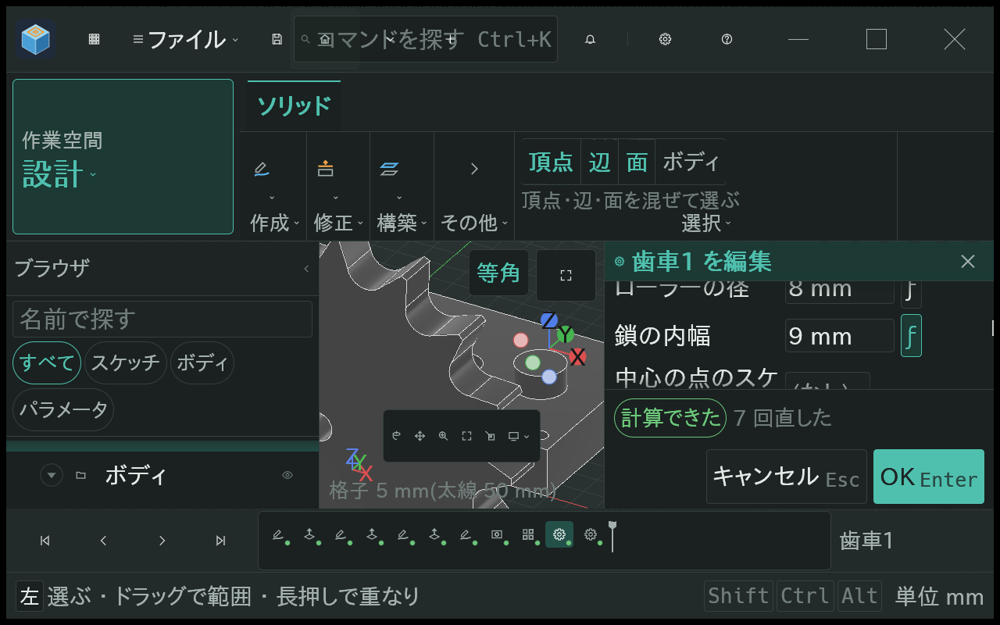 | 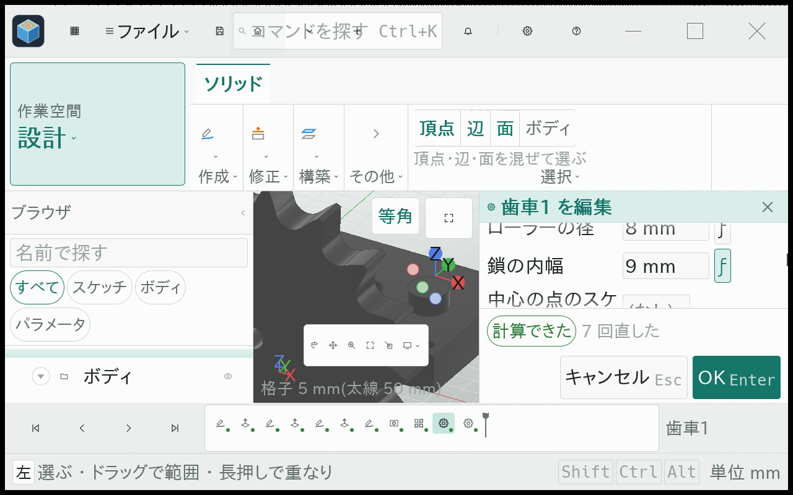 |
| 字250%の幅5 mm | 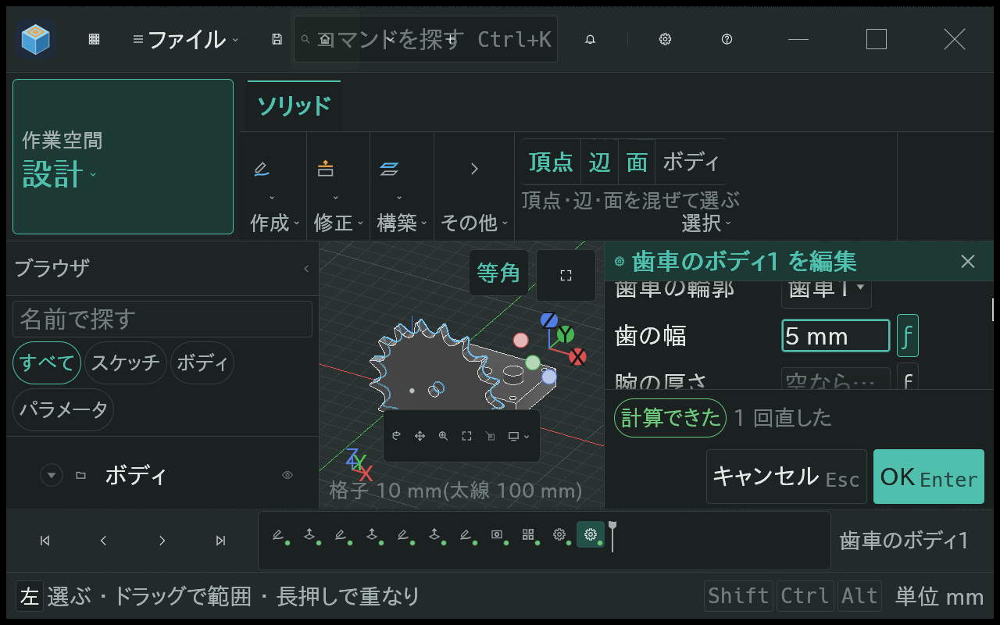 | 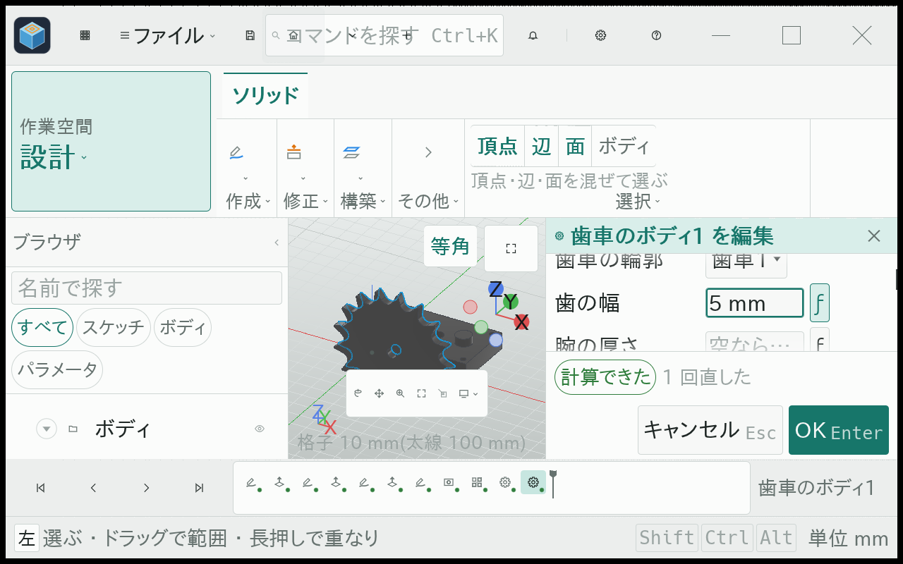 |

1280/1920幅・字100/250%・暗/明の8条件と、4種類を往復する暗/明の2条件を確認した。字250%では一覧と欄を見える所まで巻いてから操作する。手入力14/8/9 mm、歯幅5 mmの表示とOKへ到達できる。自動幅の数値は空欄の表示だけから判断せず、形の試験で確かめる。字250%のモデル全体が常に写るとの確認はしていない。

元の機能追加前の比較も保存する。

| 画面 | 追加前 | 追加後 |
|---|---|---|
| 暗い画面 | 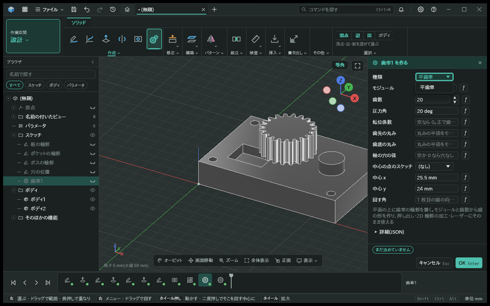 | 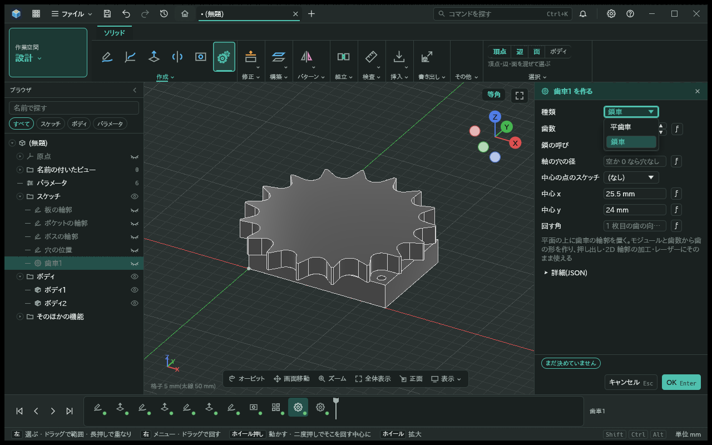 |
| 明るい画面 | 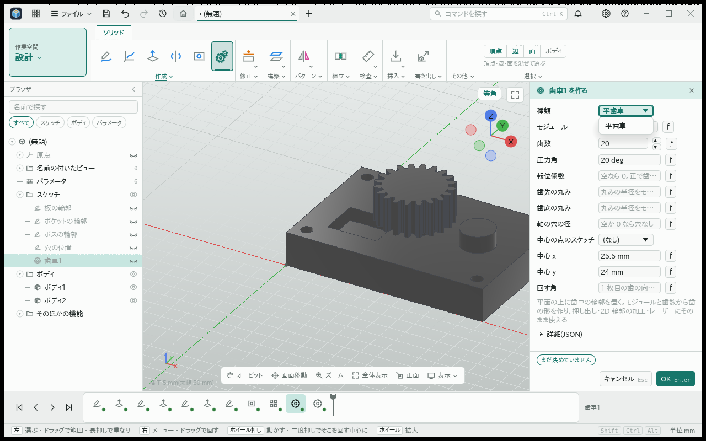 | 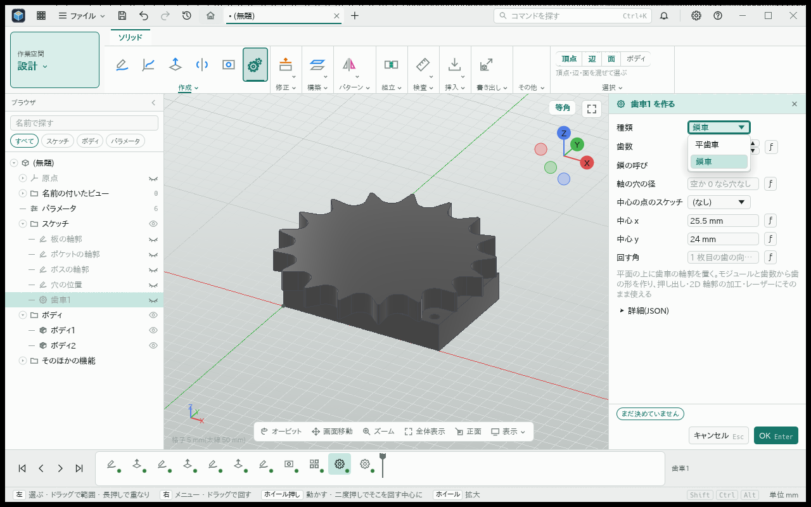 |
