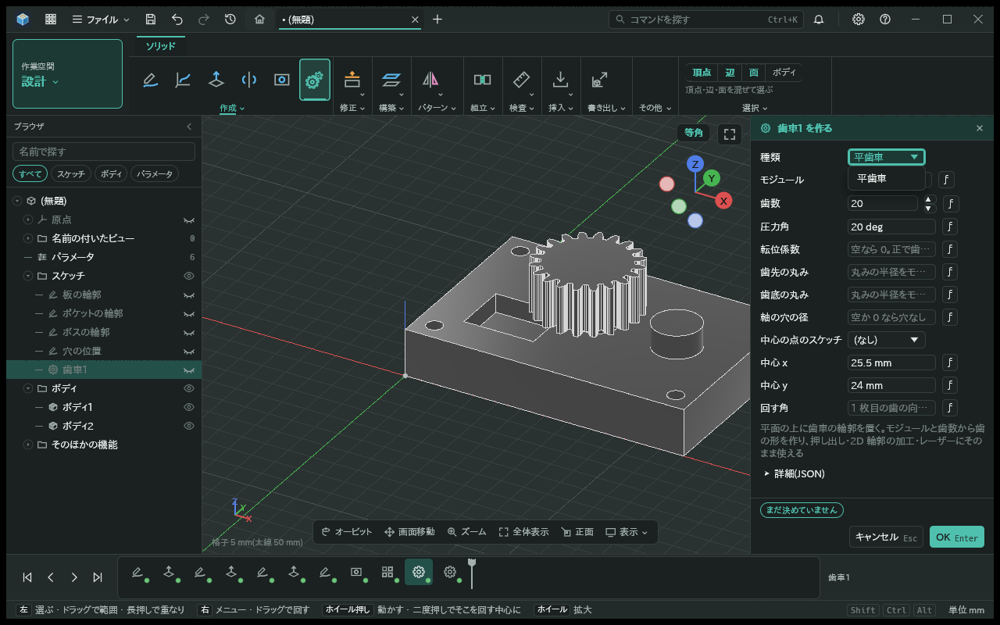
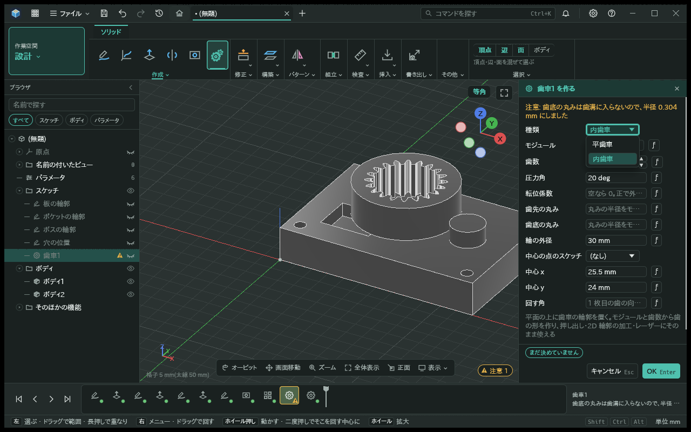
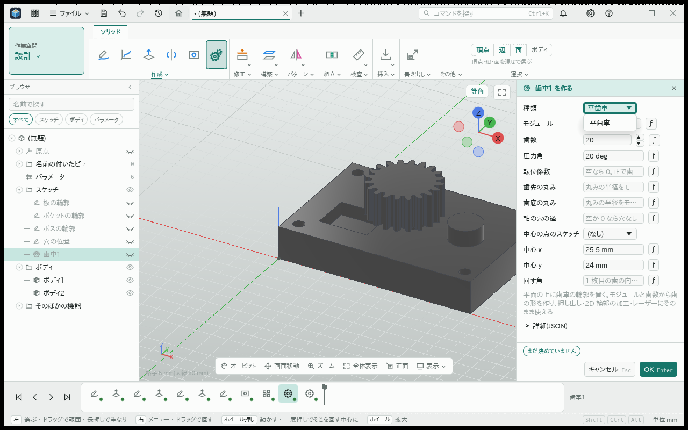
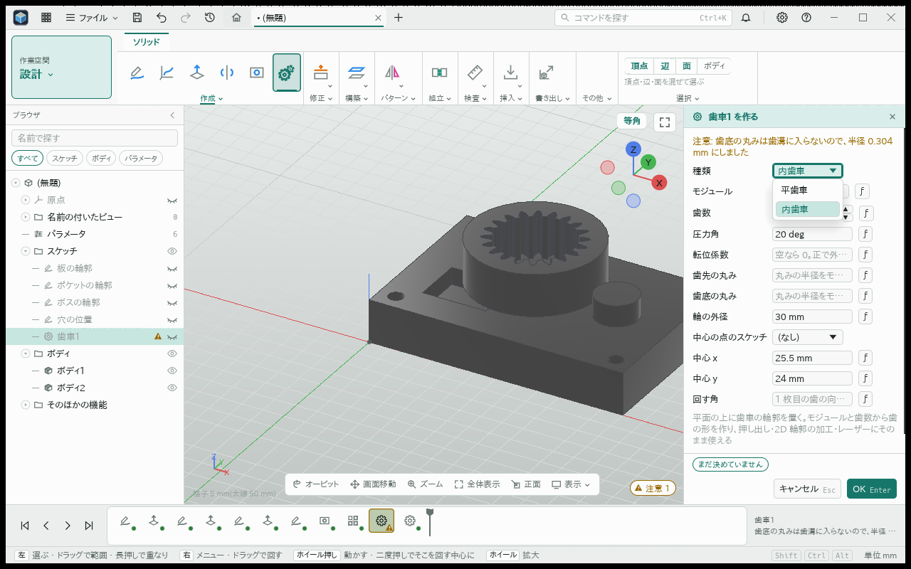

# 内歯車の輪郭とボディ

- 日付: 2026-11-04

## 作った物

- 歯車の輪郭の種類「内歯車」。既存の歯車の操作と編集パネルから選べる。内歯車だけの必須の式の欄「輪の外径」を足した。長さの単位とパラメータの式は既存の欄と同じで、軸の穴の径は内歯車では使わない。
- 外径の円を外形にし、時計回りの歯形を穴にした輪を作る。転位なしの歯先円の径は `m z − 2m`、歯底円は `m z + 2.5m`。ピッチ円の上の歯溝の幅は `πm/2`。内歯の正の転位は歯を薄くし、歯先円と歯底円をともに `2mx` 外へ動かす。
- 歯面は土台のインボリュートと二円弧の近似を使う。歯先の丸みは小径、歯底の丸みは大径に接する。歯先・歯底で歯形が重なる値は入力の誤りにする。外径が歯底円の径にモジュールの 2 倍を加えた値より小さければ、理由に最小の外径を出す。かみ合わせる相手の歯数の差の注意は出さない。
- 参照の円と諸元を出し、諸元の種類は内歯。最初の内向きの歯を X 軸に置く。内側の区間の名前は実体の歯の番号・右左・歯先・歯底に対応し、外周の円は `rim`。歯車のボディはこの輪をそのまま押し出す。腕・ボスは作らない。
- 内歯車を操作の引数で足す時は `outer_diameter` を必ず受け取り、外径とモジュールの入力精度を保つ。最小の外径付近でも操作で受け取った値と輪郭の評価が食い違わない。

## 試験

- `kmb-cad-gear` の純関数: 歯先円・歯底円、ピッチ円上の歯溝幅、閉じた交差のない輪、面の名前、転位と丸み、重なる歯形の拒否。
- 同 crate の機能・操作: 輪の面積と向き、必須の外径と最小値の理由、インチの式、式の名前の変更、最小外径での操作の精度、内歯に軸の穴を指定した時の拒否。
- 48 歯のボディは既存の `kmb-solid` の歯車の試験へ置いた。カーネルを使う形状試験の既存の置き場を使い、歯車の crate にカーネルの依存を足さない。面積と幅から体積を確かめ、諸元と外周・歯の面の名前を確認する。薄い輪の面積は外径の円の分割誤差を増幅するので、この比較では外径の円を細かく刻み、体積の許容を緩めない。
- 編集パネルは画面の部品を名前で押す台本で種類と外径を選び、暗い画面と明るい画面の前後を撮った。

## 画面

| 暗い画面・前 | 暗い画面・後 |
|---|---|
|  |  |

| 明るい画面・前 | 明るい画面・後 |
|---|---|
|  |  |
