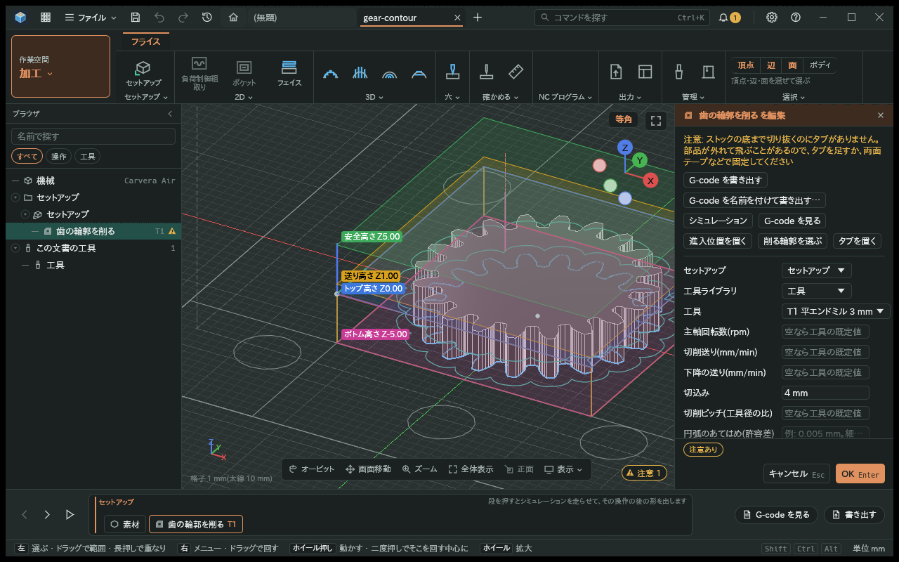
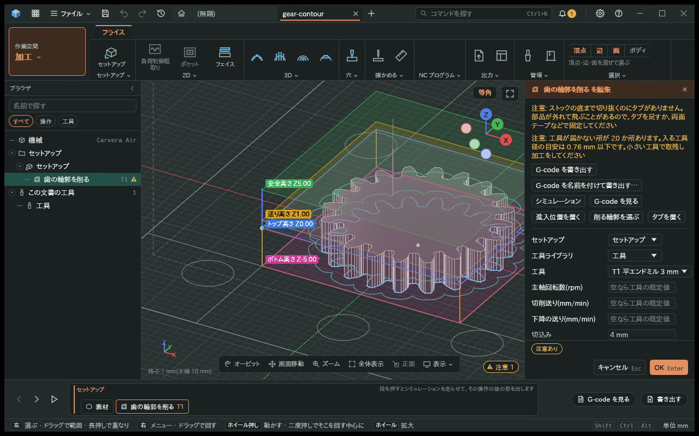
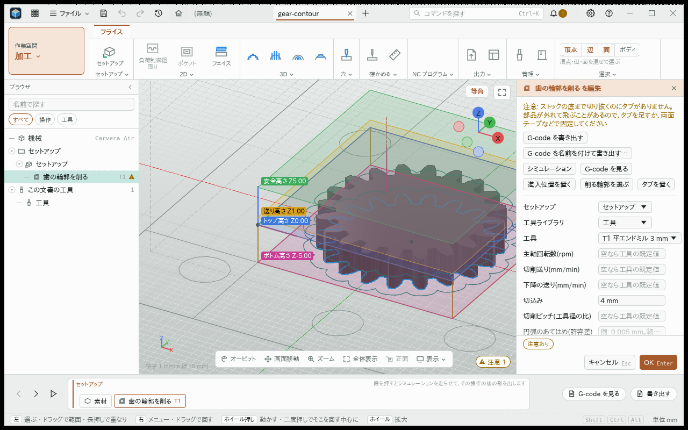
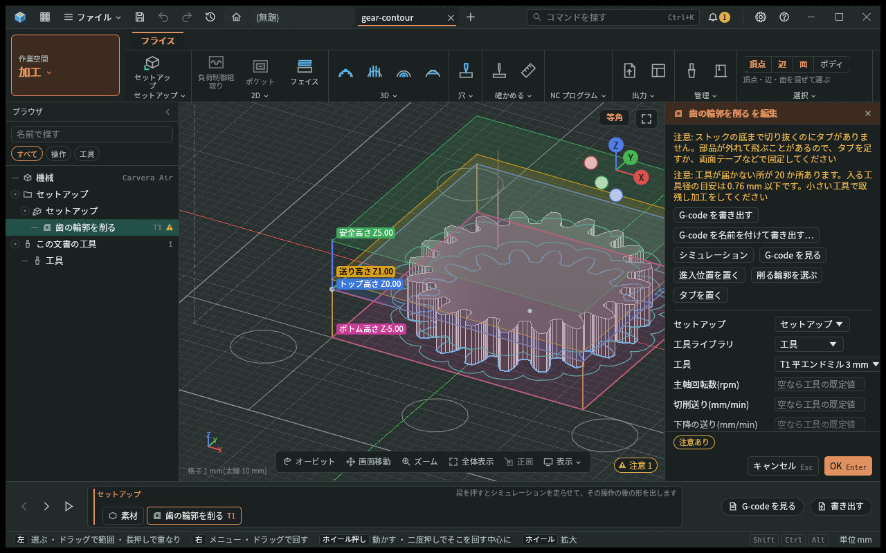
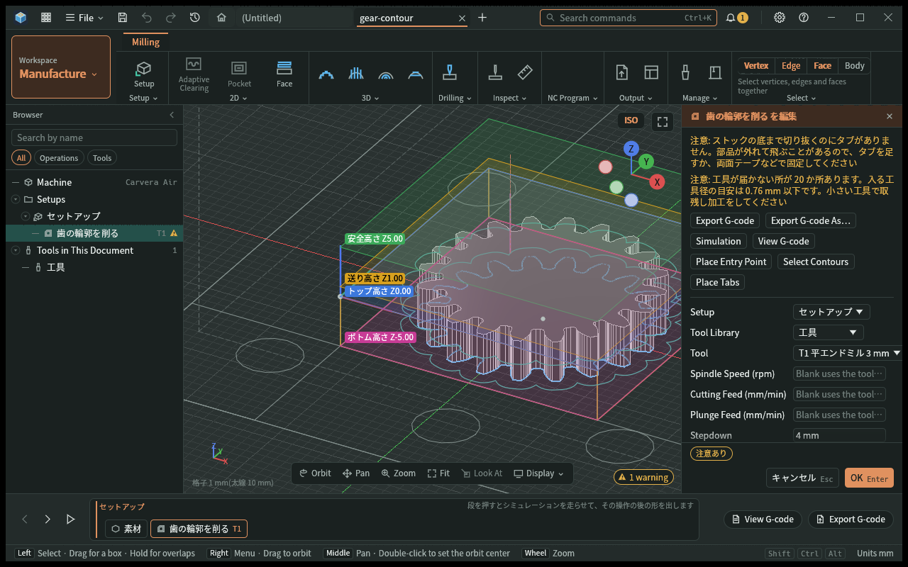
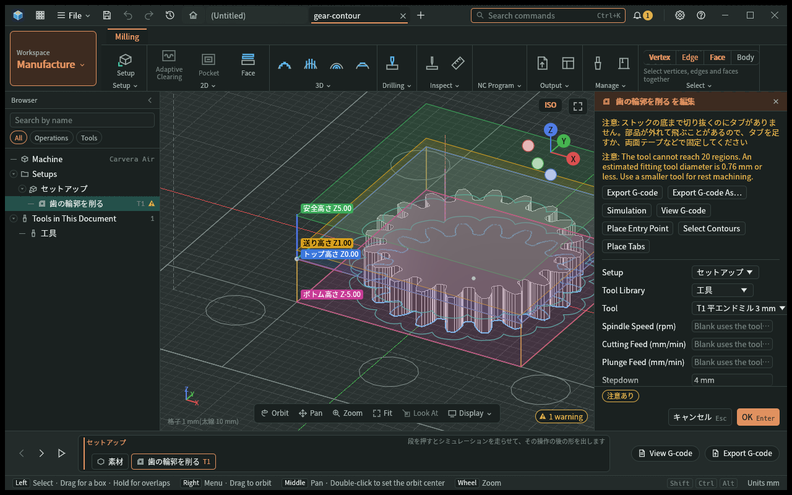
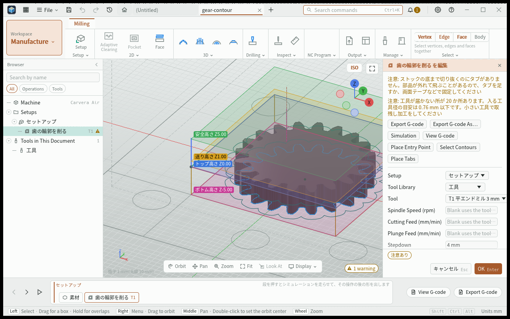
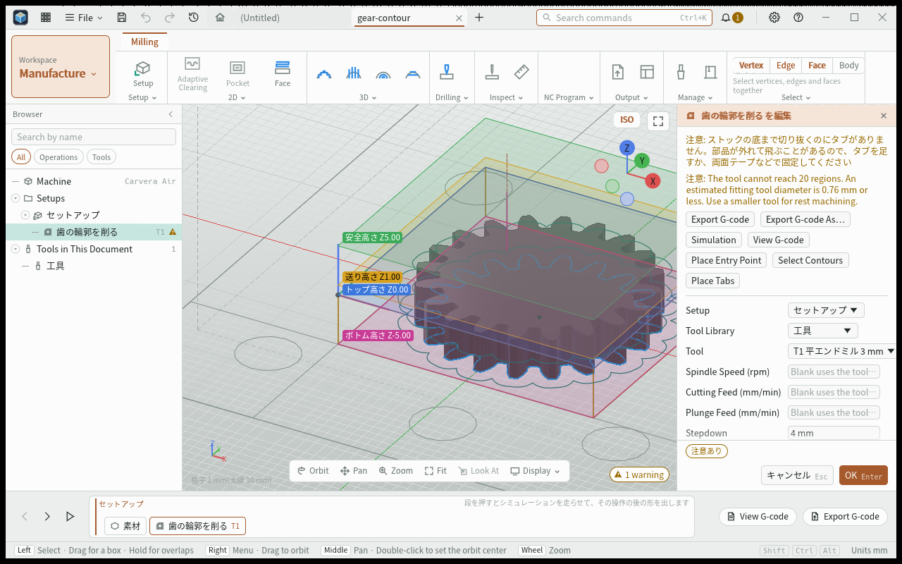

# 歯溝への工具の到達

- 日付: 2026-11-04

## 作った物

- 閉じた輪郭で、円形工具の中心経路から届かない所を注意として知らせる。到達できない連続した所の数、入る工具径の目安、小さい工具による取残し加工を案内する。経路の計算結果は変えない。
- 輪郭の線と円弧を採点し、工具中心経路までの距離と工具半径を比べる。到達できない所がある時だけ工具半径を二分して目安を求める。目安は輪郭の採点と許容差による近似であり、加工の保証値ではない。
- 削り残しを指定した時はその壁を確かめる。仕上げのために荒取りで意図して残す量は到達不足に数えない。線の上をなぞる時と開いた線には、この注意を足さない。
- CAD と加工を組み立てる `kmb-samples` の試験で、登録された歯車の機能から輪郭を作る。加工の crate は歯車の種類や寸法を知らず、CAD への依存も足さない。

## 検査済み

- モジュール 1、歯数 20、径 3 mm の平エンドミルの輪郭加工は経路を作るが、到達不足を知らせないことを修正前に再現した。固定方法の注意だけでは到達不足を知らせたことにはしない。
- 同じ入力に、到達できない所 20 か所、工具径の目安 0.76 mm 以下、小さい工具による取残し加工の注意が出る。
- 径 0.5 mm の工具では同じ歯溝に到達不足の注意が出ない。表示した径 0.76 mm を実工具へ入れ直しても到達不足の注意が消える。普通の凸輪郭、丸底の溝、輪郭の向きと始点をまたぐ連続範囲も小さな試験で確かめる。

- 同じ計算結果を日本語と英語で表示する。言語を切り替えても再計算せず、到達不足の数と工具径を保つ。暗色と明色の画面で案内を読めることを確かめる。
- CLI の G-code 書き出しと操作の実行で注意が一度だけ出る。MCP の status・操作・batch には訳の鍵、数値、説明が届く。区画別のファイル書き出しでも注意の重複がない。

## 画面

| 表示 | 変更前 | 変更後 |
|---|---|---|
| 暗色 |  |  |
| 明色 |  |  |

## 注意の受け渡し

- 計算側は訳の鍵、文字または数値の引数、訳がない時の説明を型付きの出力で渡す。コアは言語や加工の種類を知らない。古い文字列の注意と文書の保存形式は変えない。
- 画面は選択中の言語で型付きの注意を表示する。古い文字列の注意や文書の名前は翻訳しない。未知の鍵や欠けた引数には説明を出す。不正な注意のデータは黙って捨てず診断を出す。原文を表示する口も保つ。
- status と書き出しの補足は、古い注意と型付きの注意を別々に運ぶ。経路の持ち主を型付きの番号でたどり、同じ加工の注意を重ねない。CLI は説明を表示し、MCP は訳の鍵と数値も返す。

## 言語の画面

| 表示 | 文字列だけの注意 | 型付きの注意 |
|---|---|---|
| 日本語・暗色 |  |  |
| 日本語・明色 |  |  |
| 英語・暗色 |  |  |
| 英語・明色 |  |  |

## 未確定

- 工具径の目安は輪郭を採点した近似であり、実機加工の保証値ではない。実機の試し削りは行っていない。
- CLI の台本の `--export` はボディの書き出しを選ぶため、NC ファイルを出せない。G-code の専用コマンドか操作の実行を使う。
