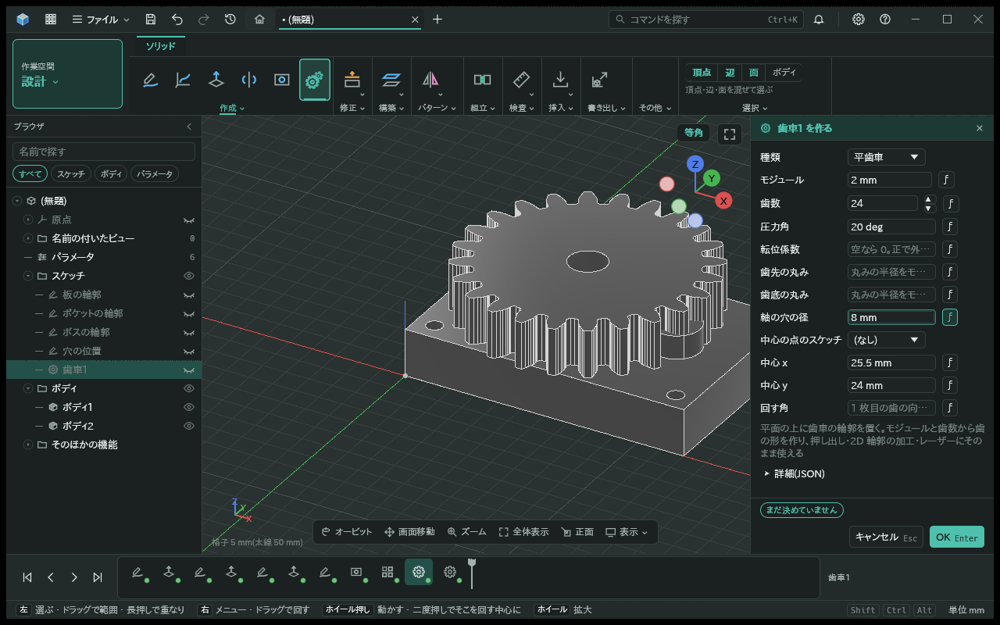
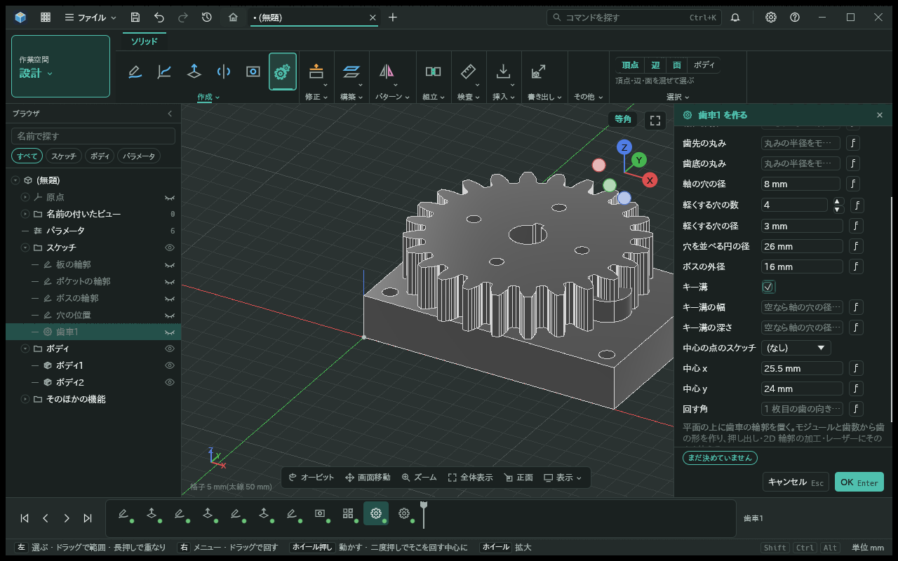
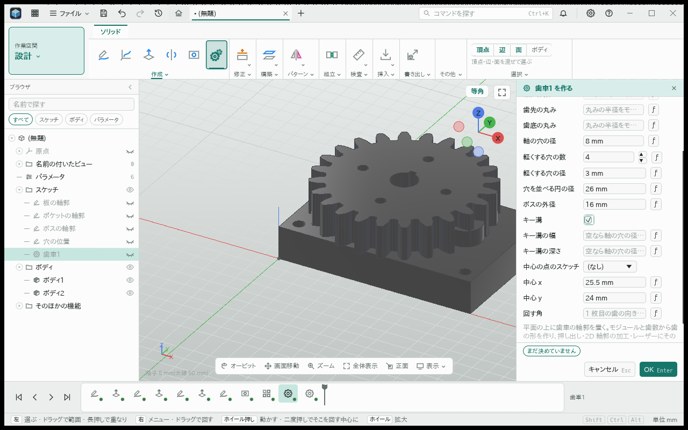
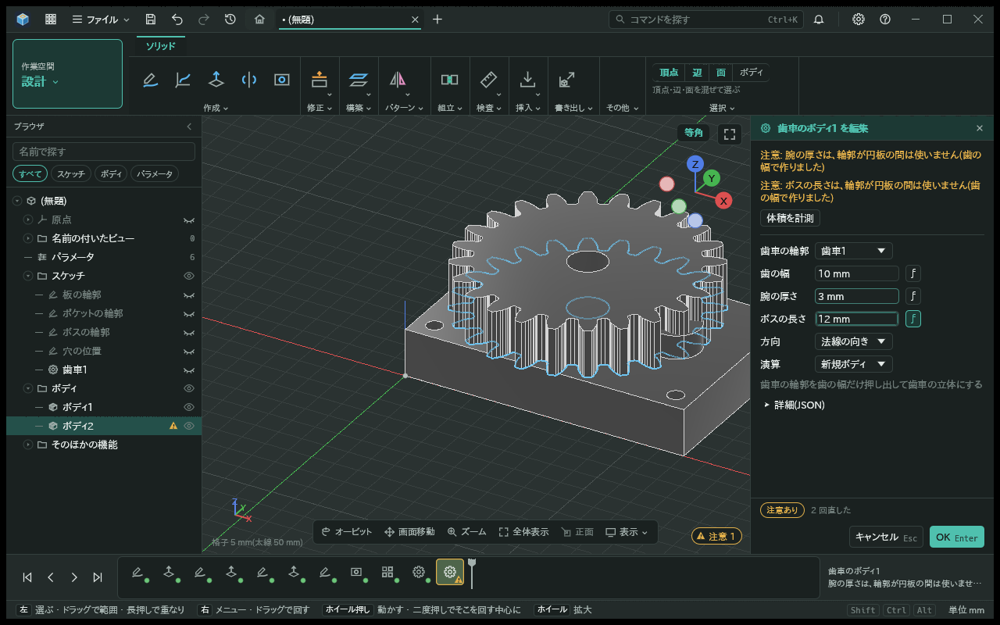
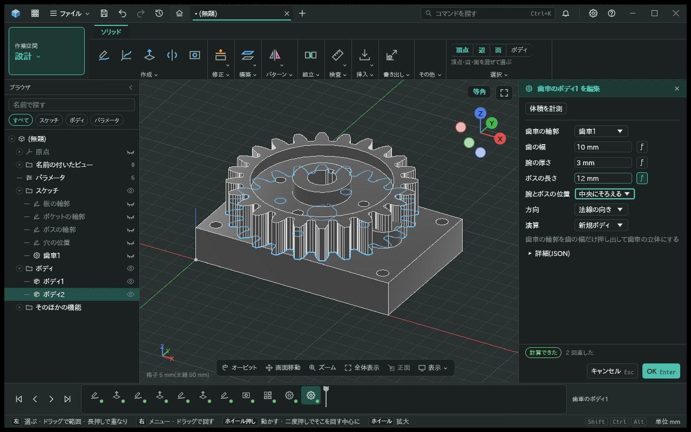
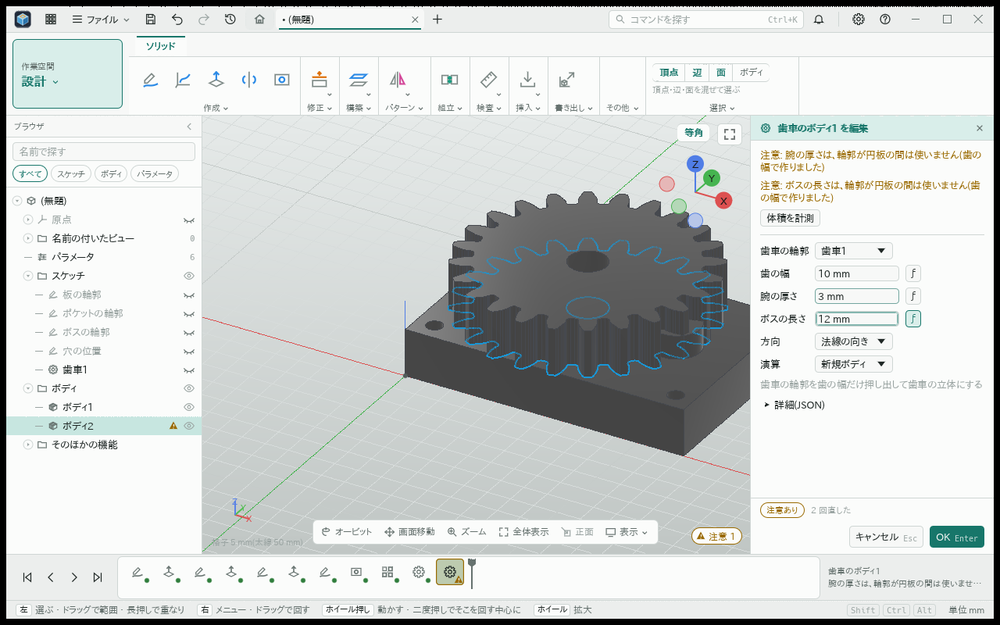
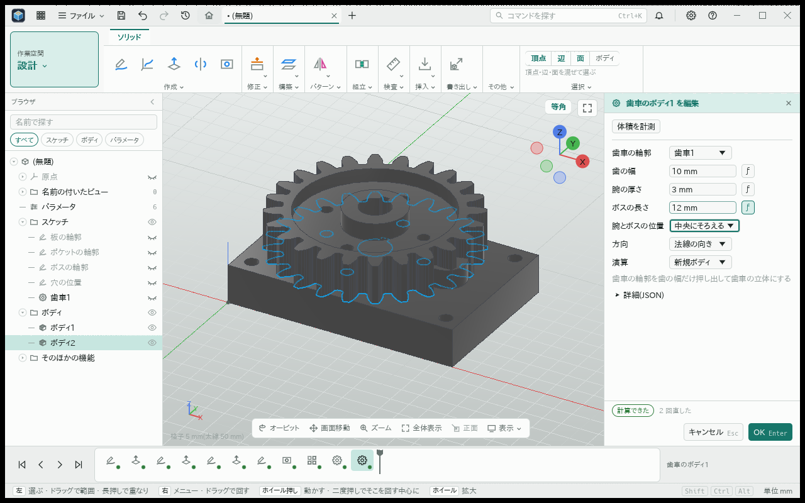

# 歯車の穴とボスとキー溝

- 日付: 2026-11-04

## 作った物

- 平歯車の輪郭 `cad.gear@1` に軽くする穴の数・径・並べる円の径、ボスの外径、キー溝の有無・幅・深さを持つ。長さの欄は mm を既定にし、式を受ける。
- 軽くする穴を腕に等間隔で並べる。リム・ボス・隣の穴にかかる時は入力の誤りにし、置ける穴の径の上限を示す。キー溝と接触する穴も拒否する。
- キー溝の幅と穴側の深さは JIS B 1301 の平行キーの表から選ぶ。径の最初の区分は 6 mm 以上 8 mm 以下、以降は下の端を含まず上の端を含む。表の外の径では幅と深さの両方を指定する。
- 歯車のボディ `cad.gear_body@1` で腕の厚さ・ボスの長さを使う。「腕とボスの位置」で歯の幅の中央か片側にそろえる。キー溝はボスの長さ全体に通る。

## 決めたこと

- 内歯車とラックでは穴・ボス・キー溝を指定しない。既定の輪郭を分割せずボディへ渡し、内歯の歯形の穴とラックの有限な境界を保つ。
- リムの内縁を歯底からモジュール一つ分内側に置く。腕とボスはその内側を分ける。輪郭全体の `profile` と線には分割線を入れず、厚さを分ける領域は歯車の crate 内の型 `gear.parts@1` で渡す。
- 厚さが同じ時は全体の輪郭を一度押し出し、分割面を作らない。厚さが違う時は領域をそれぞれ押し出す。
- 厚さが違う歯車の「交差」は対応していない誤りにする。新しいボディ・結合・切り取りと、同じ厚さの交差は使える。

## 足した言葉

用語表の「歯車」に軽くする穴・ボスの外径・キー溝の各欄と「腕とボスの位置」を記載する。

## 試し方

歯車の輪郭を作り、モジュール 2 mm・歯数 24・軸の穴 8 mm、軽くする穴 4 個・径 3 mm・並べる円 26 mm、ボスの外径 16 mm、キー溝ありにする。歯車のボディで歯の幅 6 mm・腕の厚さ 3 mm・ボスの長さ 12 mm を指定する。

## 画面

平歯車の輪郭では軽くする穴とキー溝を指定し、ボディでは腕の厚さとボスの長さを変える。土台のボディにも腕の厚さ・ボスの長さの欄はあり、輪郭が円板の時はこれらを使わない注意を出す。領域を分けたボディでは指定した厚さで作り、「腕とボスの位置」を選べる。

| 画面 | 土台 | 穴・ボス・キー溝を指定した輪郭とボディ |
|---|---|---|
| 暗い輪郭 |  |  |
| 明るい輪郭 |  |  |
| 暗いボディ |  |  |
| 明るいボディ |  |  |

## 組合せの確認

内歯車・ラック・平歯車の種類の往復と、穴・ボス・キー溝の編集を、暗い画面と明るい画面で確かめた。画面の大きさは 1280×800 と 1920×800、字の大きさは 100% と 250%。大きい字では編集パネルをスクロールして欄と OK に届くことを確かめた。250% の写真は欄の見え方の確認で、モデル全体が収まることは示していない。

画面の台本はアプリの作業空間を通常のクリック・入力の経路で動かし、CPU で描画して確認する。OS の窓や GPU での描画の確認とは区別する。
