# スケッチを開く時の視点

- 意図: スケッチを開くたびに視点が正面へ回り、今の見方のまま描き足したい時に困る。
- 仕分け: A・作る(正面へ回す働きがあり、切る設定を加える)。

## 作った物

設定の「設計」に「スケッチを開く時」を追加した。「開く時に正面から見る」は既定で入。切にすると、現在の向き・中心・倍率・ずらしを引き継いでスケッチを開く。傾き、透視か平行か、視野角も保つ。

PC 設定はスケッチの編集器が持ち、文書のタブ間で共有する。カメラは文書ごとのビューに持ち、設定や文書の形状データへは入れない。保存には共通の壊れない書き込みを使う。安全モードでは保存済み設定を読まず、変更しても書かない。壊れた設定では既定を使い、元のファイルを残す。

## 決めたこと

設定変更だけでは編集中の視点を動かさず、次に既存スケッチを開く時や新しく作る時に反映する。既定では従来どおり平面を正面から見て全体を収める。切でも「正面から見る」を押せば正面へ戻せる。

専用ビューから別のスケッチへ直接切り替える時も、編集器を初期化する前の実際の視点を渡す。ほかの編集器の視点や操作は変えない。

## 画面

| 条件 | 変更前の既定表示 | 設定を切って開く |
|---|---|---|
| 暗い画面 | 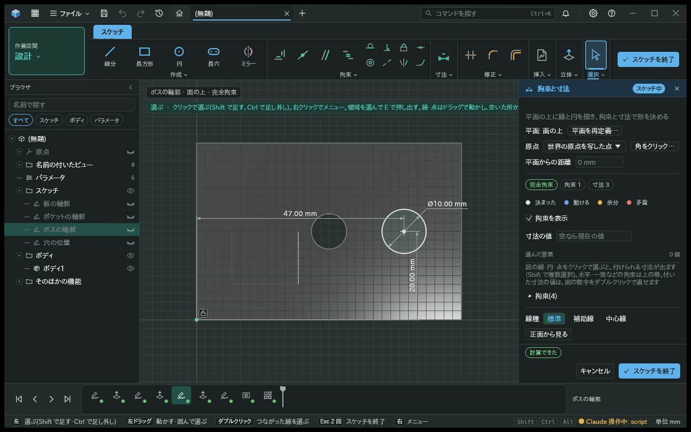 | 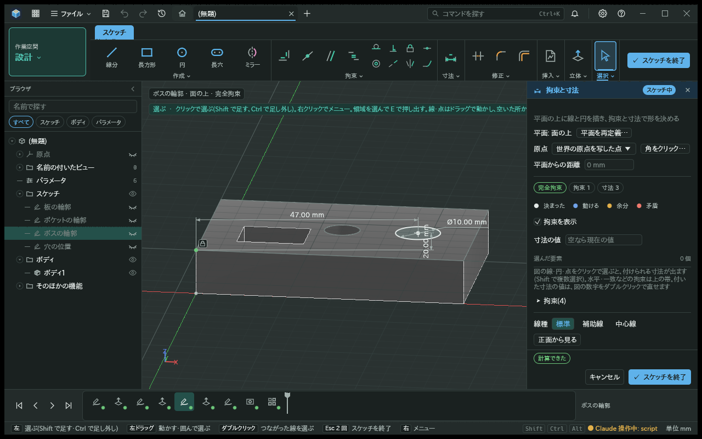 |
| 明るい画面 | 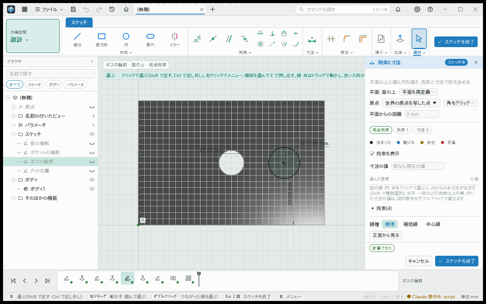 | 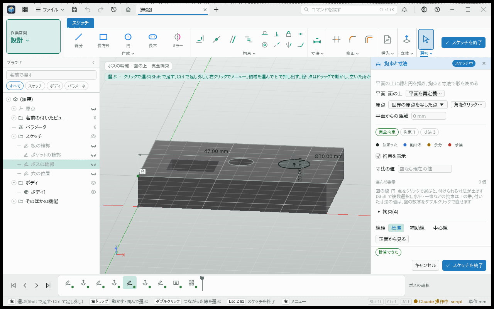 |

設定は既定で入になっている。

| 暗い画面 | 明るい画面 |
|---|---|
| 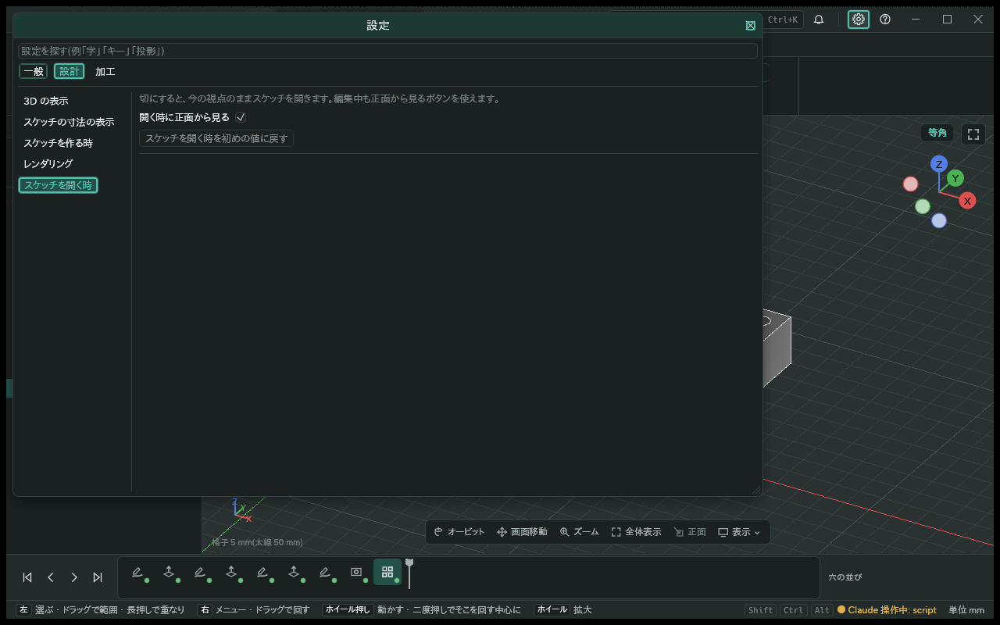 | 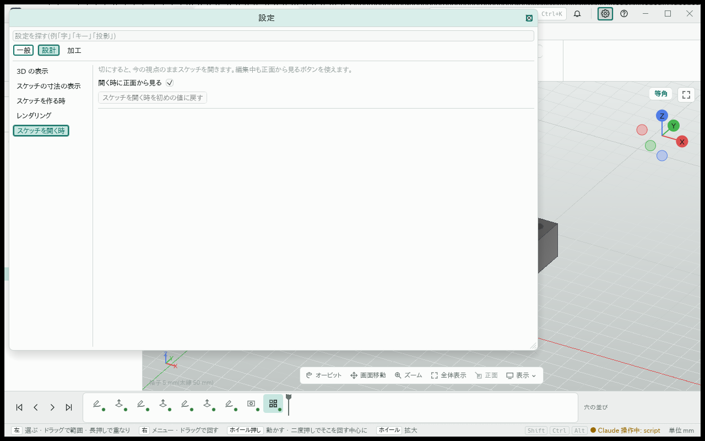 |

切の時は倍率も保つため、狭い作図領域ではモデルの一部だけが見えることがある。1280 幅・字 250 % の検査でも、全体が見えるよう自動で倍率を変えず、同じ視点を保った。パレットの詳細は通常のスクロールで見る。

字 250 % の保持画面。1280 幅ではモデルの一部だけが見える。

| 暗い画面 | 明るい画面 |
|---|---|
| 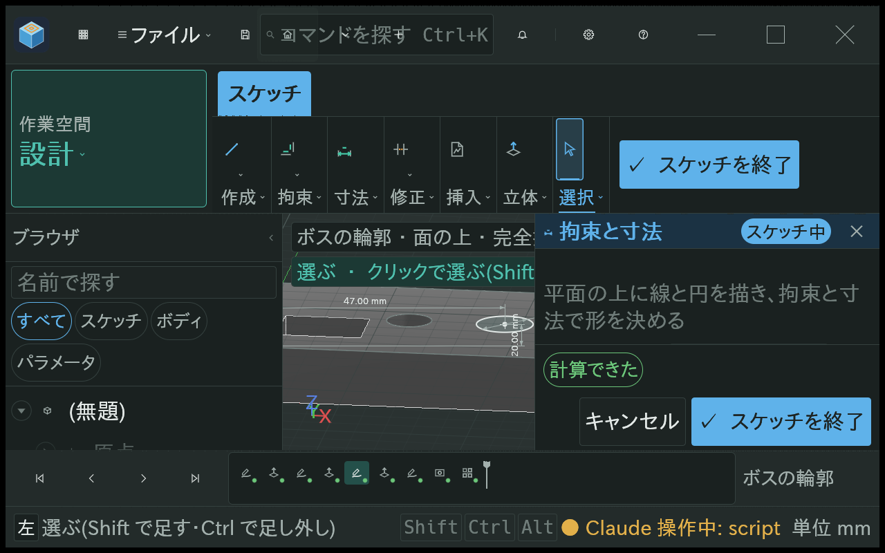 | 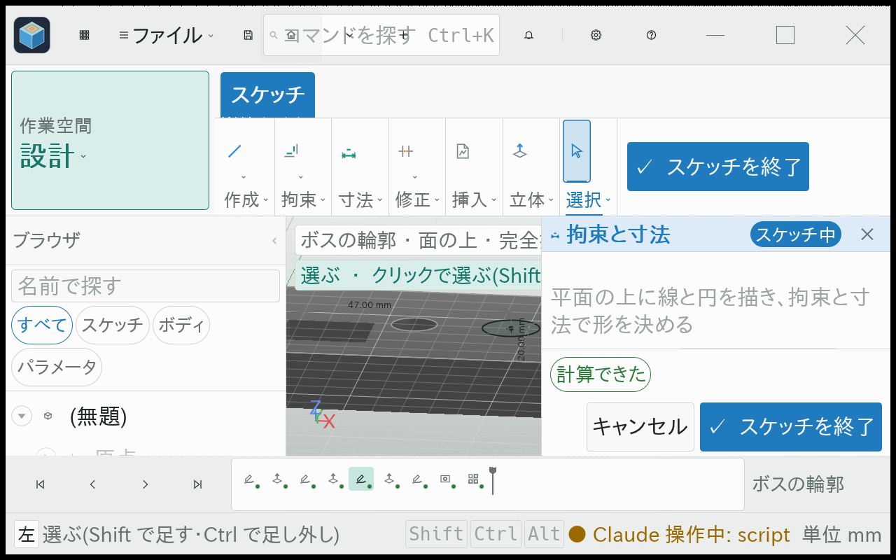 |

面を通常操作で選び、新しいスケッチを開いた編集中の画面。作成開始時の視点と親面の参照を確かめたもので、編集を完了して保存した画面とは分けている。

| 暗い画面 | 明るい画面 |
|---|---|
| 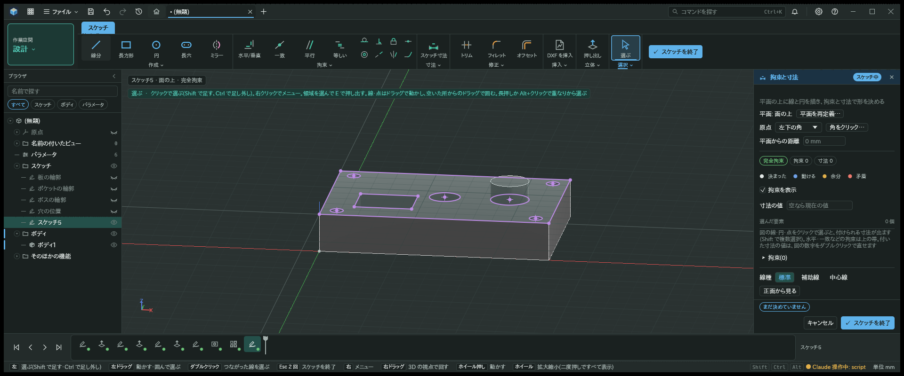 | 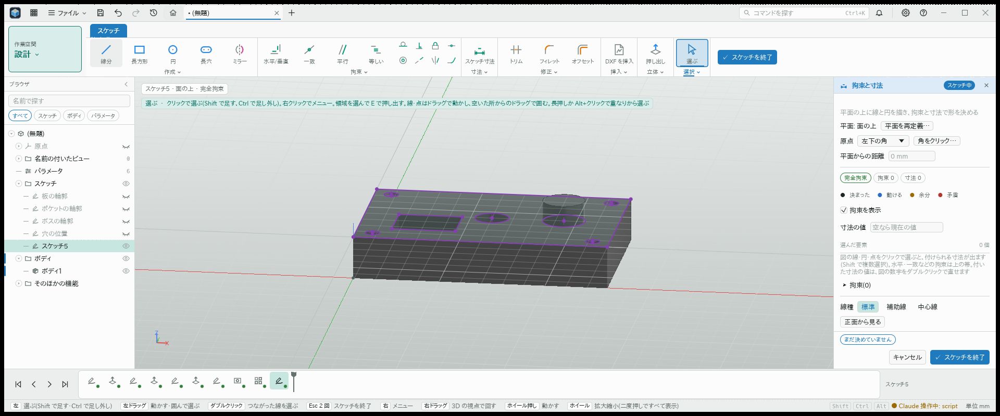 |

設定が切でも、通常のボタンで正面へ戻せる。

| 暗い画面 | 明るい画面 |
|---|---|
| 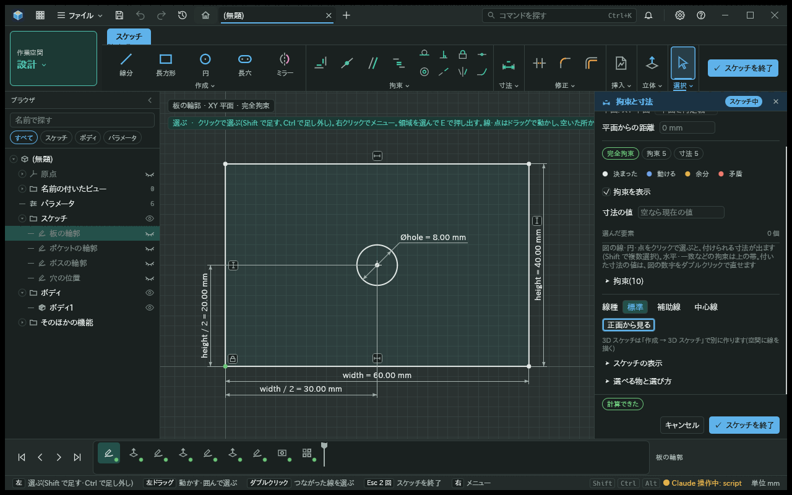 | 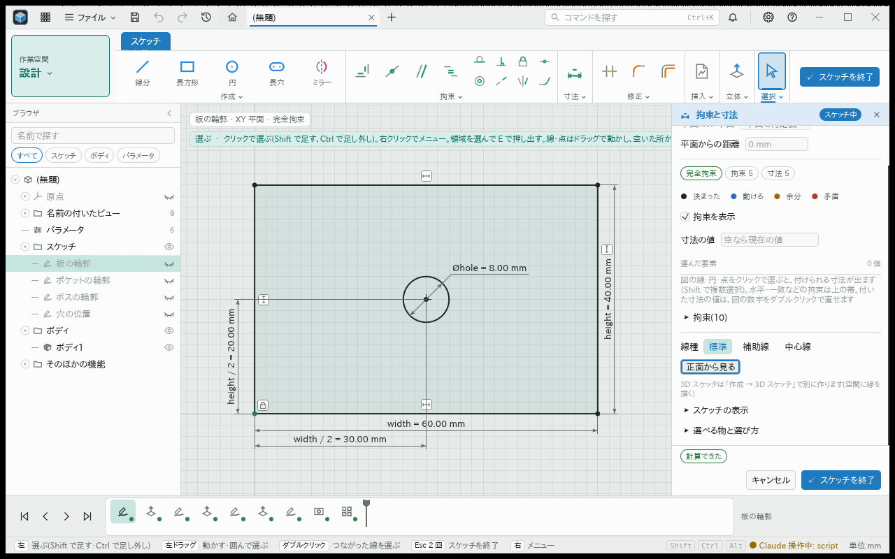 |

設定を入へ変えた後、次に既存スケッチを開くと正面から表示する。

| 暗い画面 | 明るい画面 |
|---|---|
| 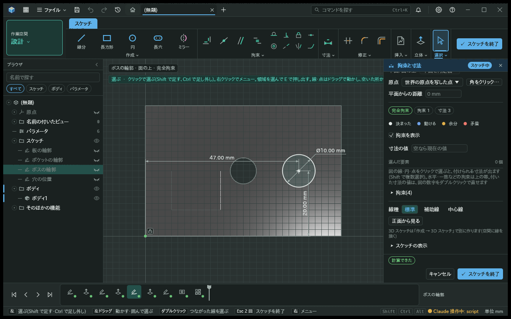 | 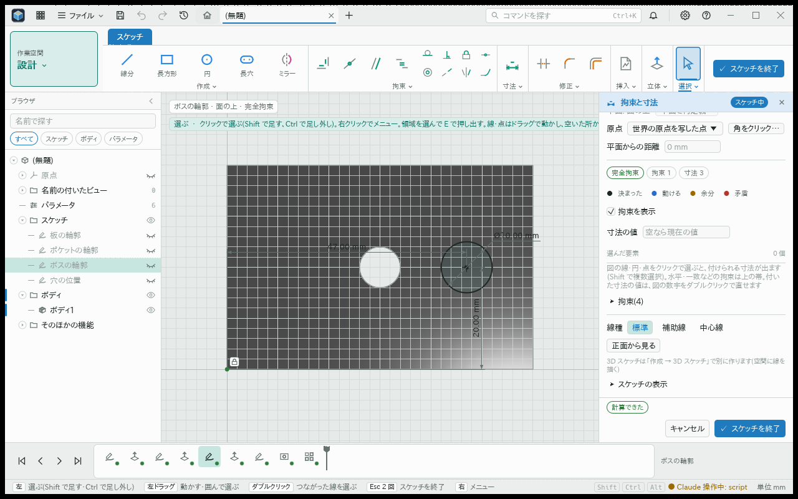 |

## 試し方

設定を切って斜めから開き、線を描く・選ぶ・寸法を付ける。設定変更だけでは編集中の視点が動かず、開き直した時に反映されることを確かめる。別のスケッチへの直接切替、通常の面選択からの新規作成、手動の「正面から見る」も確かめる。

画面の検査は実際の作業場を CPU で描画し、通常の UI 操作を通したもの。OS の窓や GPU の描画の検査ではない。
