# 直近の補助線の交点

- 意図: 線を描く時、直前に通った 2 つの中心・中点の補助線が交わる所に点を置きたいが吸い付かない。
- 仕分け: A・作る(補助線の推論があり、直近の交点を優先する設定を加える)。
- 日付: 2026-11-08

## 作った物

設定の「設計」に「スケッチの補助線」を追加した。「直近の補助線の交点にスナップ」は既定で切。入れると、直前に通った 2 点から出る縦・横の補助線の交点を優先する。線分の向きの推論でその位置を動かさない。

中心は既存の点、中点は元の線分から位置を求める。点を追加して仮の吸い付き先の番号が変わっても、同じ線分の中点を使う。破線と交点の輪は、既存の吸い付きの案内と同じ描き方で出す。

設定を入れて作図中は、表示している入力点と補助線の交点を画面の名前で探せる。名前で押す操作も通常のクリックとして扱う。

設定はスケッチの編集器の中で保持し、同じ窓の文書のタブ間で共有する。文書やプロセス全体の static には入れない。設定の保存には共通の壊れない書き込みを使い、安全モードでは今回だけの値にする。

## 決めたこと

設定が切の時は既存の並びの案内と向きの推論を維持する。既にある点や曲線への吸い付きが優先され、Ctrl を押している間は補助線による吸い付きを止める。

## 足した言葉

スケッチの補助線、直近の補助線の交点にスナップ。

## 試し方

設定を入れ、線分の道具で中心や中点を順に通り、両方の補助線が交わる所へカーソルを動かす。設定を切った場合も通常の並びの案内が残る。暗い画面・明るい画面で設定と補助線を確認する。

サンプルの部品で「ボスの輪郭」を開き、線分の始点を円の中心に置く。原点と中心へカーソルを通し、中心の縦線と原点の横線が交わる所を押す。線分を終え、「スケッチを終了」で点を確定する。

画面操作の台本では、`ui_tree` で表示中の `スケッチの入力点 2` と `スケッチの補助線交点` を探し、`ui_click` で押せる。カーソルを点へ通す操作は、既存の `script` の `hover` を使う。設定が切、作図中でない、画面の外の場合は今回の入力点の名前を出さない。

## 画面の比較

設定を追加する前と、追加後の既定値。高さは 800、字の倍率は画面の設定で変えた。追加後は画面操作の確認のため MCP に接続している。

| 幅・字の倍率・明暗 | 追加前 | 追加後（既定は切） |
|---|---|---|
| 1280・100%・暗 | 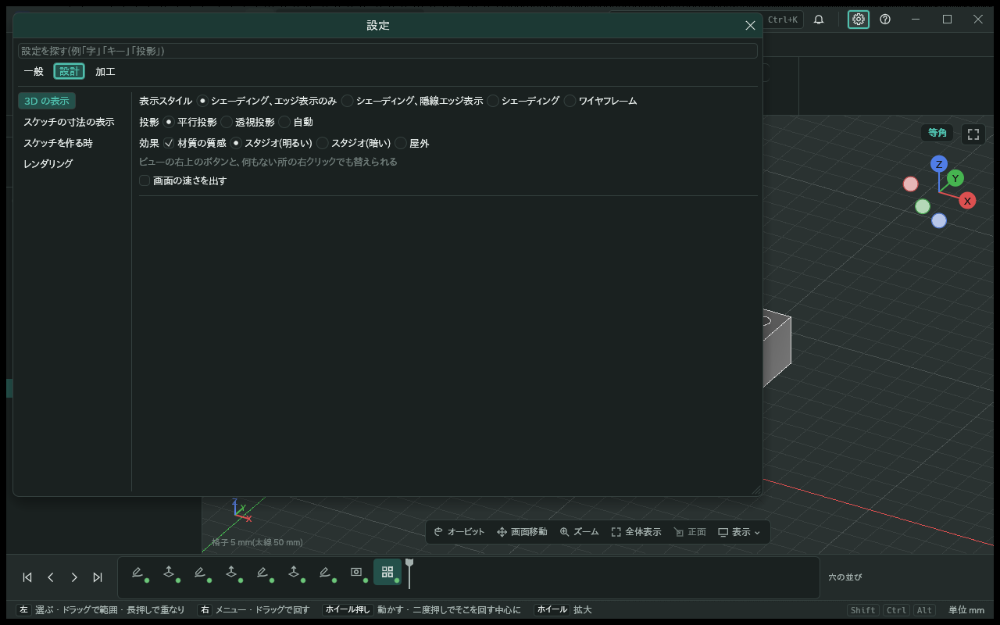 | 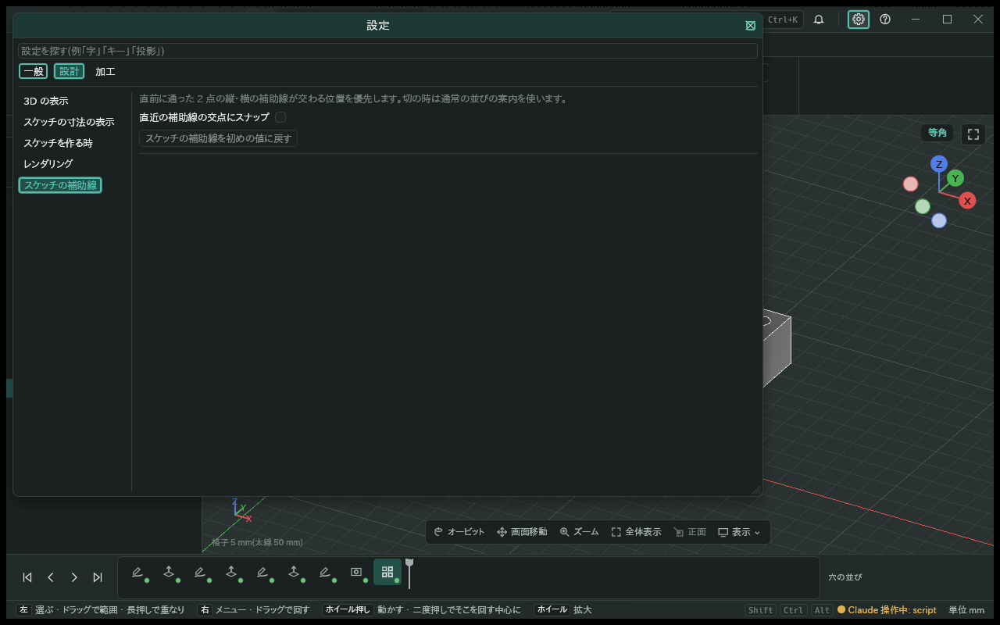 |
| 1280・100%・明 | 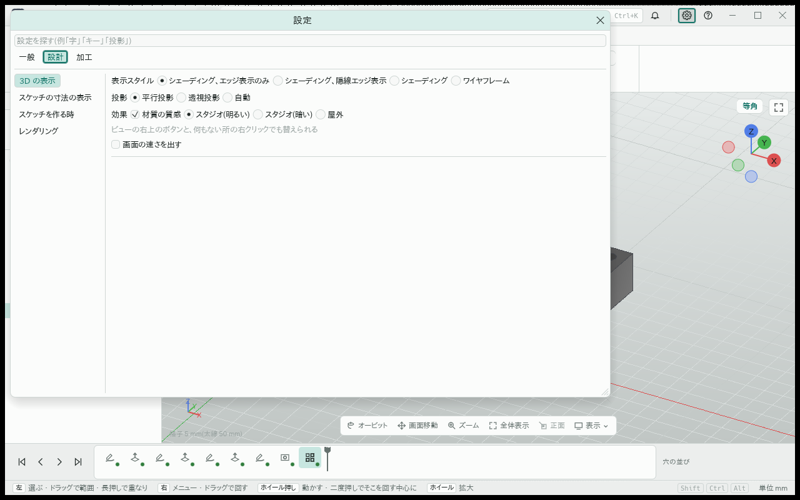 | 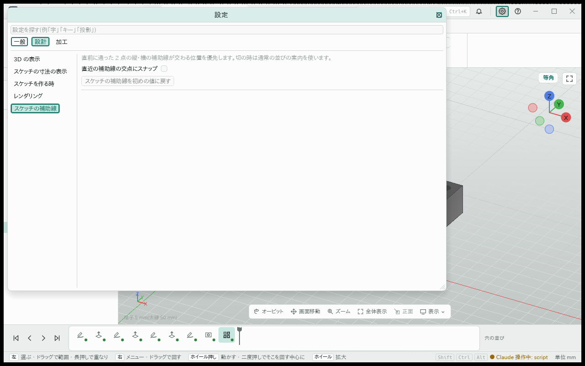 |
| 1280・250%・暗 | 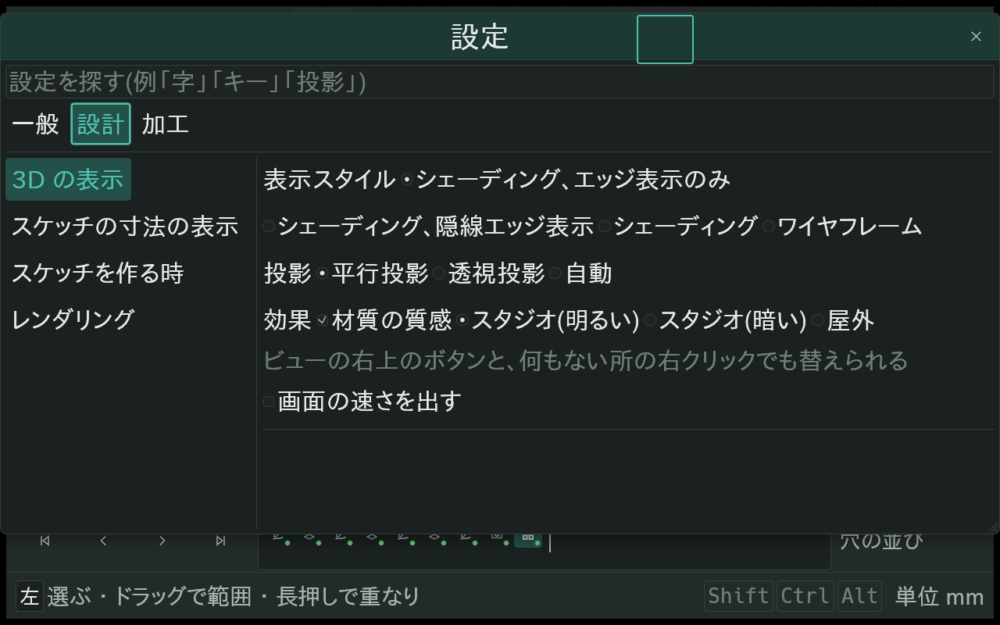 | 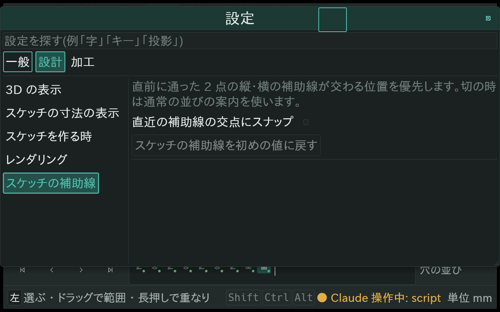 |
| 1280・250%・明 | 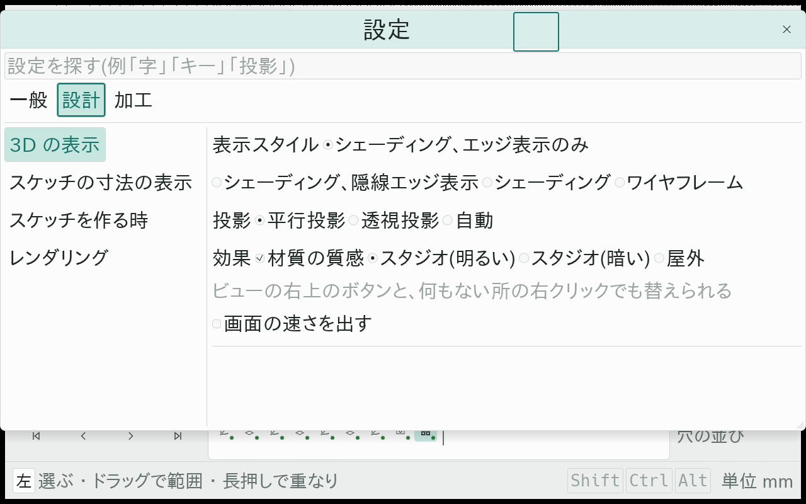 | 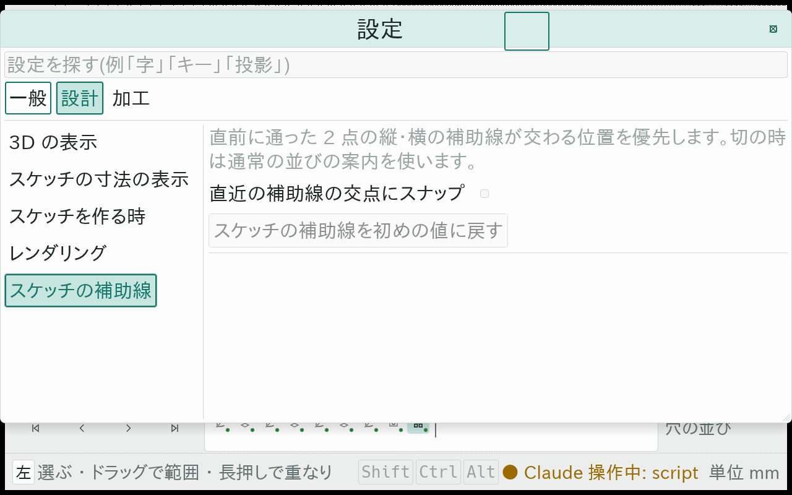 |
| 1920・100%・暗 | 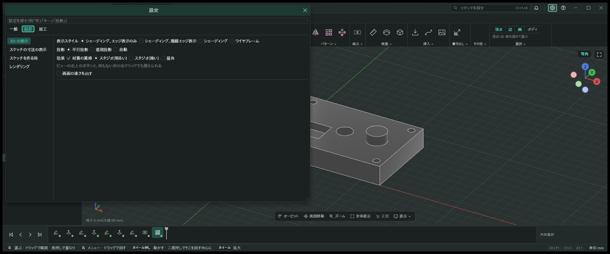 | 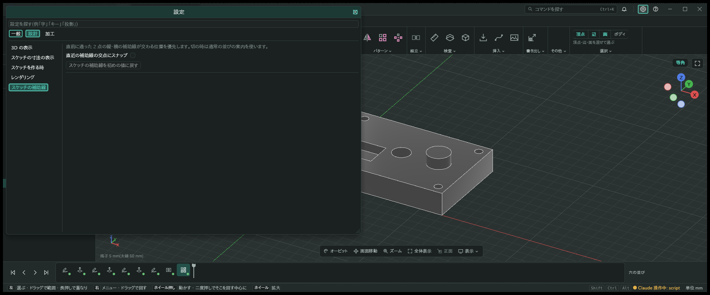 |
| 1920・100%・明 | 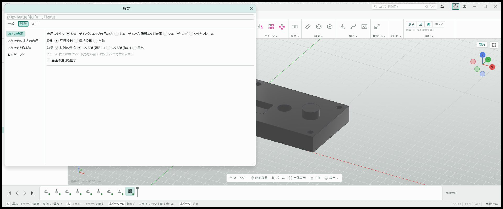 | 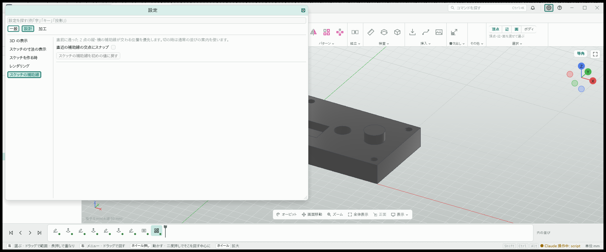 |
| 1920・250%・暗 | 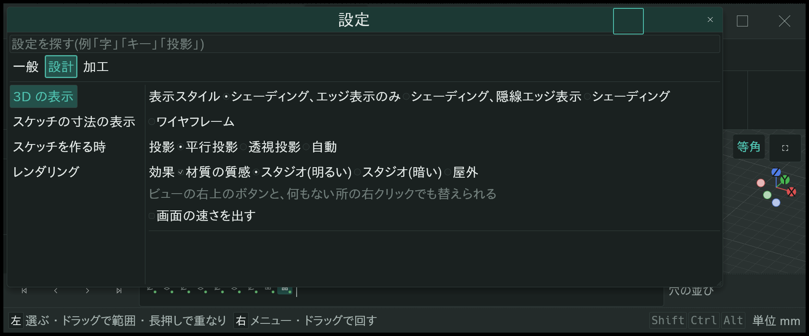 | 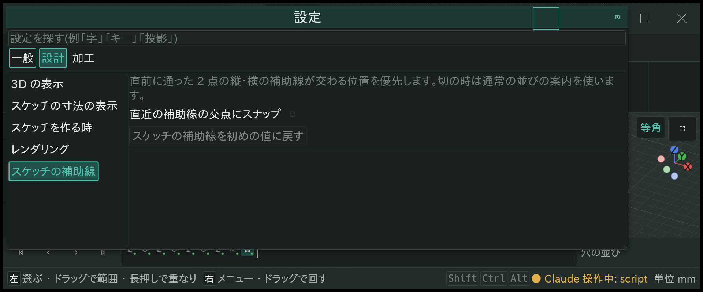 |
| 1920・250%・明 | 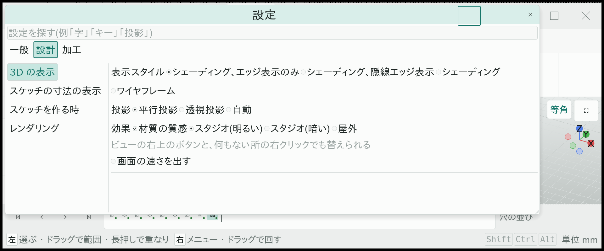 | 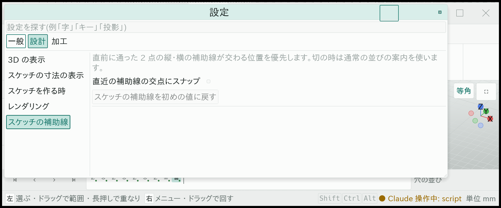 |

補助線が交わる所へカーソルを動かした例。この後、名前で通常クリックし、点を確定した。

| 暗い画面 | 明るい画面 |
|---|---|
| 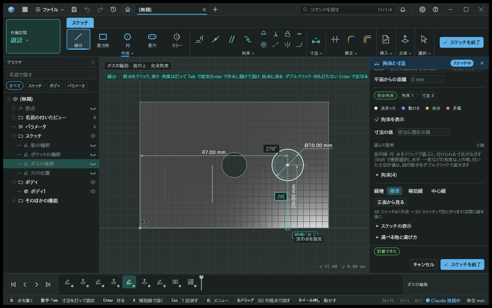 | 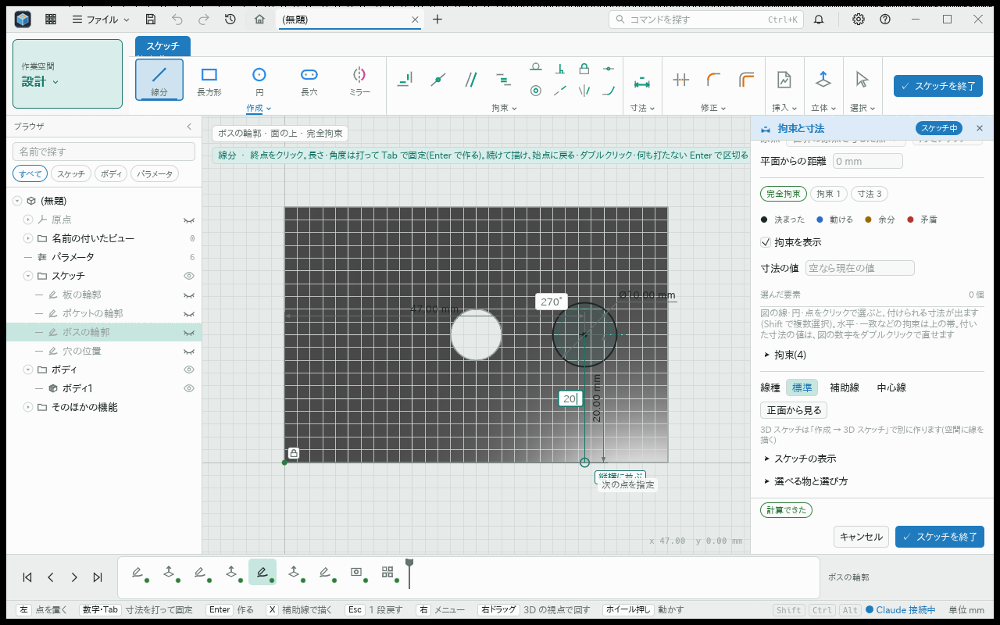 |
