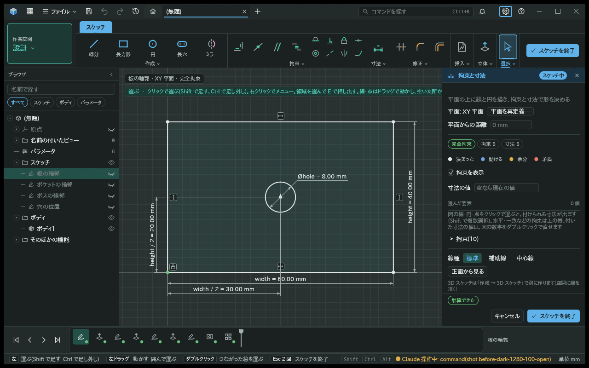
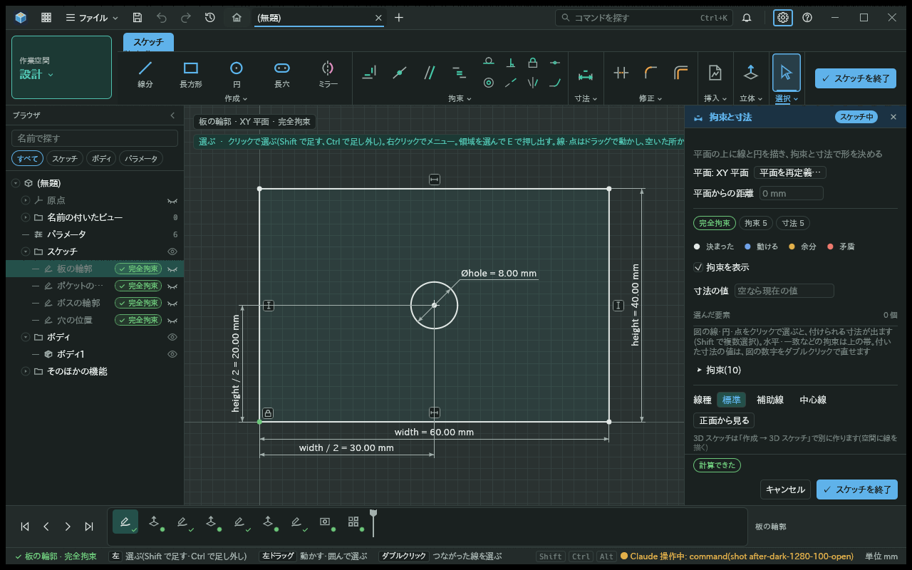
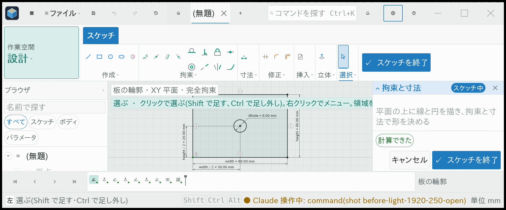
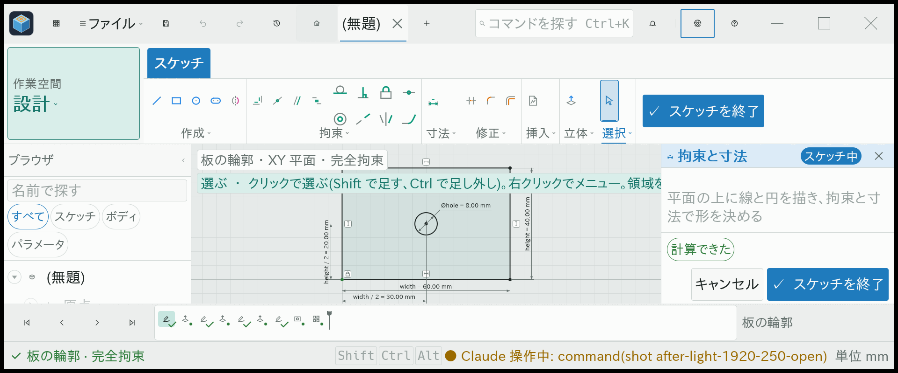

# スケッチの行と編集中の状態

- 日付: 2026-11-09
- 意図: スケッチの行と画面下の帯を見るだけで、拘束が足りているか、今何を直しているか分かってほしい。
- 仕分け: A・作る。編集パネルの題には拘束の状態があり、行と帯に出す道が無かった。

## 作った物

ブラウザとタイムラインのスケッチの行に、完全拘束・拘束不足・過剰な拘束を出す。拘束不足では残りの自由度も出す。狭いタイムラインでは印で区別し、行にマウスを置くと状態の文を読める。

スケッチを開くと、画面下の帯に機能の名前と現在の拘束の状態が出る。閉じると帯から消える。ほかの機能を開いている時は、その機能の名前を同じ位置に出す。操作の途中の案内と知らせは引き続き優先する。

完全拘束は確認の印、拘束不足は白丸、過剰な拘束は注意の印で区別する。色だけに頼らず、暗い画面と明るい画面でそれぞれの役割の色を使う。文は日本語と英語の表示言語に従う。

## 決めたこと

- 機能の要約には、スケッチが既に計算した解の拘束状態を出す。画面から解き直したり、自由度を数え直したりしない。
- 編集器が持つ計算済みの見本は、その機能を開いている間だけ使う。閉じた行は文書の現在の成功した結果を読む。
- 再計算中や機能の失敗・抑制・ロールバック時には、前の成功を現在の拘束状態として出さない。
- 画面の共通部分は機能の種類の名前や要約の日本語を判定しない。拡張点から文と印を受け取り、文書の保存形式は変えない。

## 確かめ方

完全拘束・拘束不足・過剰な拘束の見本で、機能の要約、行の文と印、残りの自由度を確かめる。MCP の通常の画面操作で行をダブルクリックし、編集の帯が出ることと、「スケッチを終了」で閉じると消えることを日本語と英語で確かめる。開閉だけでは文書を変えない。

実際の画面で、1280×800 の暗い画面と、1920×800・文字250%の明るい画面を比べた。どちらも通常の設定から MCP の接続を入れ、画面の部品を名前で探して開閉した。操作の間の文書が変わらず、帯は開いた時だけ出ることを確かめた。前は main の同じ見本、後はこの実装の同じ見本で撮った。

| 条件 | 前 | 後 |
| --- | --- | --- |
| 暗い画面・1280×800 |  |  |
| 明るい画面・1920×800・文字250% |  |  |
