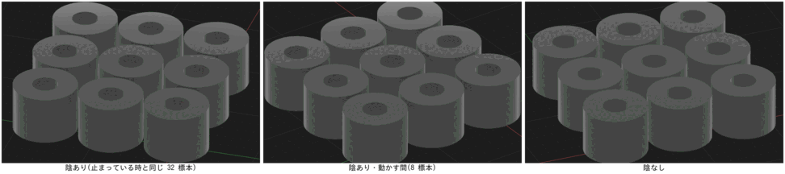
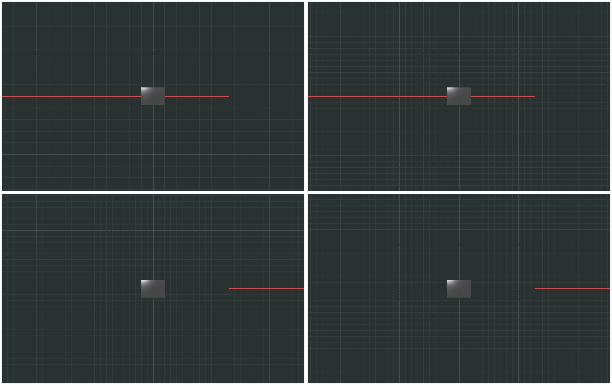
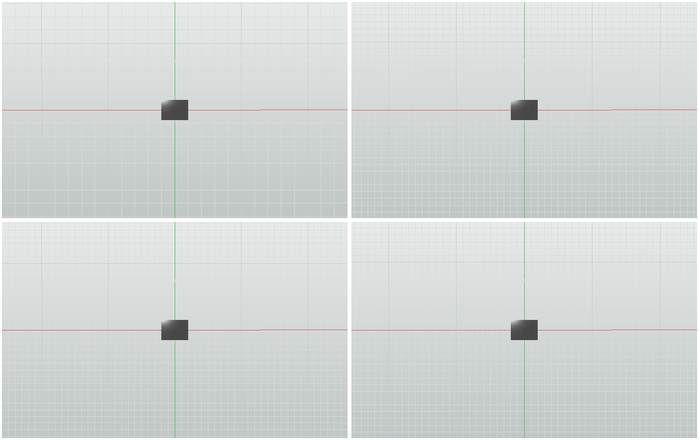
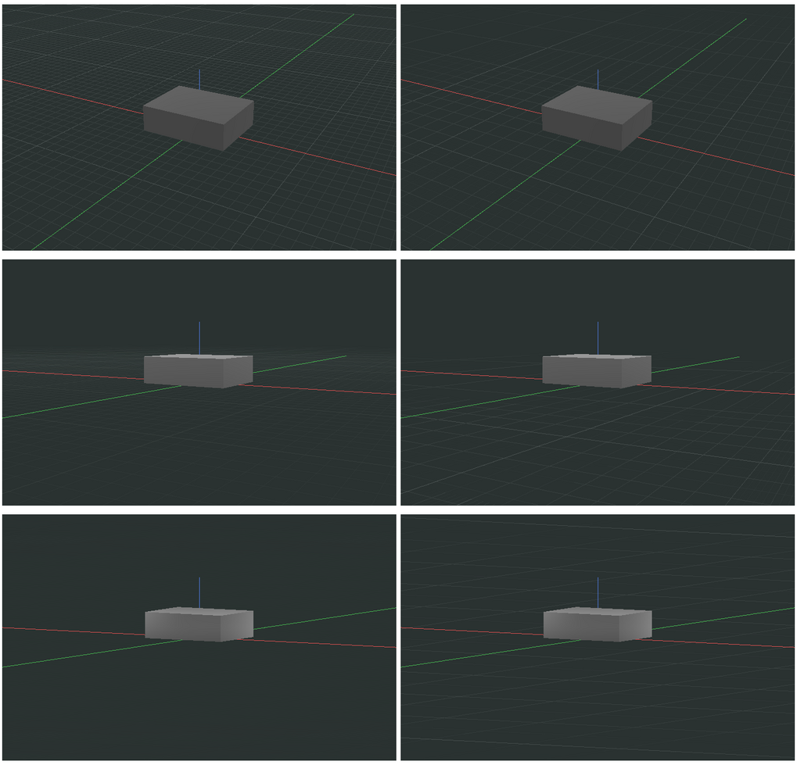
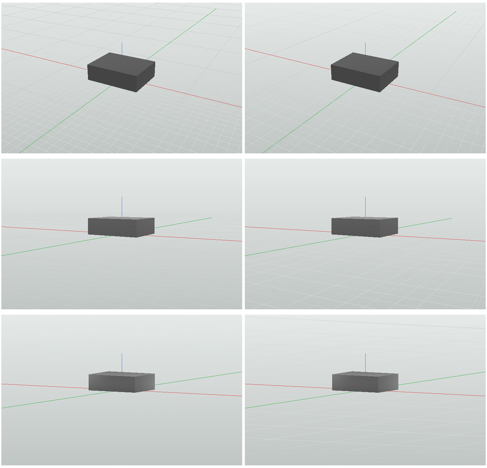
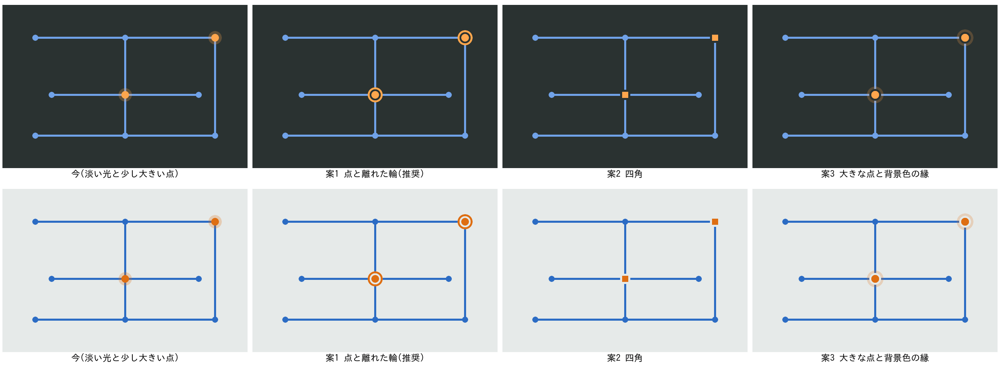

# 回す間の陰・格子の段の替わり目・スケッチで選んだ点の印

- 意図: 重い形を回すとかくつき、拡大や浅い角度で格子がちらつき、スケッチで選んだ点がどれか分かりにくい。
- 仕分け: A・直す(陰・格子・点の印の土台はある。動かす間の陰と段の替わり目の薄め方、選んだ点の印を直す)。
- 日付: 2026-11-09

## 作った物

### 回す・動かす間の入り隅の陰(kmb-ui-view3d の `gpu3d.rs`)

- GPU で描く時、回す・動かす間(描画の設定の「動かす間は軽く」が入っている時)は、入り隅の陰の標本の数を 32 から 8 に減らす(`AO_SAMPLES_MOVING`)。止まると 32 に戻して描き直す。数だけを替え、描く先は作り直さない(作り直すとちらつく)。
- 描いた絵を使い回す鍵に「軽い陰か」を入れ、止まった時に描き直す。
- 測る道具: `cargo test -p kmb-ui-view3d --lib ao_bench -- --ignored --nocapture`(`KMB_BENCH_SIZE`・`KMB_BENCH_TUBES`・`KMB_BENCH_FRAMES`・`KMB_BENCH_OUT`)。

CPU で描く Vulkan(1920×1200、穴のある筒を並べた形、回しながら 12 回の中央の値):

| 形 | 陰なし | 陰あり(32 標本) | 動かす間(8 標本) |
|---|---|---|---|
| 三角形 52 万 | 260 ms | 910 ms | 500 ms |
| 三角形 7.4 万 | 143 ms | 600 ms | 299 ms |
| 三角形 3.3 万 | 128 ms | 499 ms | 262 ms |

陰の重さは形の三角形の数より画面の画素の数で決まる(三角形が 16 分の 1 でも陰の分は半分ほどしか減らない)。動かす間は陰の分が 6 割ほど減り、フレームの時間は 45〜50 % 短くなる。実際の GPU の数は PC で同じ道具を流して確かめる。

### 格子の段の替わり目と浅い角度(kmb-ui-view3d の `raster.rs` の `guide_segments`。CPU と GPU の描画の両方)

- 格子の段を 1・5 × 10^k(5 倍と 2 倍を交互)にした(`grid_level`・`grid_coarser`)。上の段の線は必ず下の段の線に重なる。1・2・5 の刻みでは 2 の段と 5 の段の線が重ならず、2 つを重ねて薄めると間隔が乱れる。
- 線の濃さは、その線の入るいちばん上の段の、その場所の画面の上の線の間隔(画素。線の向きと直角に測る)で決める(`grid_seen`)。8 画素で消え、16 画素(5 の段は 40 画素)から先は濃さそのまま。段の替わり目では消える段と現れる段の濃さがつながる。
- 太線も段の間隔(70〜140 画素)で細い線の色から太い線の色へ寄せる(`GRID_BOLD`)。太線の段が替わる時も飛ばない。
- 透視や浅い角度では遠くの線ほど間隔が詰まるので、場所ごとに細かい段から消え、粗い段だけが残る(縞に乱れない)。
- 低く見た時に格子を消し始める高さを下げた(視線の高さ 0.06 から薄れ、0.03 で消える。前は 0.14 から薄れ 0.08 で消えた。`GRID_LOW`)。
- 格子の真ん中と半分の大きさは丸めない(丸めると、拡大や回す中心の移動で薄れる輪が飛んだ)。
- 区間の濃さは 32 段に丸め、続く区間を 1 本にまとめて線の数を抑える。
- ビューの左下の札「格子 ○ mm(太線 ○ mm)」は、半分より濃く見えるいちばん細かい段と、太く見えるいちばん細かい段を出す。

上から見て段の替わり目の前と後(上の段が前の作り、下の段が今。左右が替わり目の前と後):

斜めの透視・低い透視(6 度)・低い平行(5 度)(左が前の作り、右が今):

写真は CPU の描画で撮る道具で撮った: `KMB_SHOT_OUT=<フォルダ> cargo test -p kmb-ui-view3d --lib grid_shots -- --ignored`。

### スケッチで選んだ点の印(kmb-ui-sketch の `view/draw.rs`)

- 選んだ点は、点のまわりに背景色のすき間をあけ、選んだ色の輪(半径 8、太さ 2)で囲む。カーソルの下ならさらに外を淡く光らせる。前は少し大きい点と淡い光だけで、線の交わる所では見分けにくかった。

案(左端が前の作り、2 番目が採った形):

## 決めたこと

- 動かす間の陰は、強さを切らず標本の数だけを減らす(切ると押した時と離した時に陰が出入りしてちらつく)。描く先は作り直さない。
- 格子の段は回す中心の拡大だけで決める。透視では半分の間隔の段まで線を置き、場所ごとの間隔で濃くする。

## 試し方

- 試験: `crates/kmb-ui-view3d/src/view3d/grid_tests.rs`(段の替わり目の前後で線の濃さがほとんど変わらない、替わり目の間もいちばん粗い線は濃い、浅い角度で濃い線どうしが 6 画素より近づかない、5 度でも地面の格子が残る)。前の作りではこのうち 3 つが落ちる。
- 人の手順: 設計の作業空間で、マウスのホイールで寄ったり離れたりして格子が段ごとにぱっと替わらないこと、右ドラッグで低く回して地面の格子が残ること。スケッチで点を 1 つ押し、カーソルを離しても輪で分かること。
