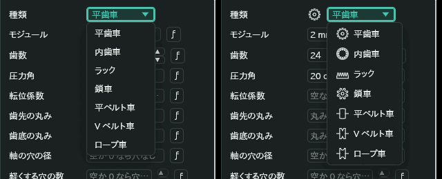
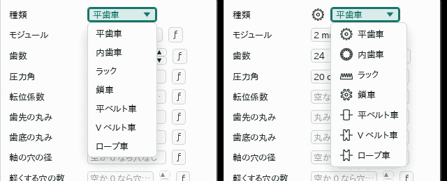
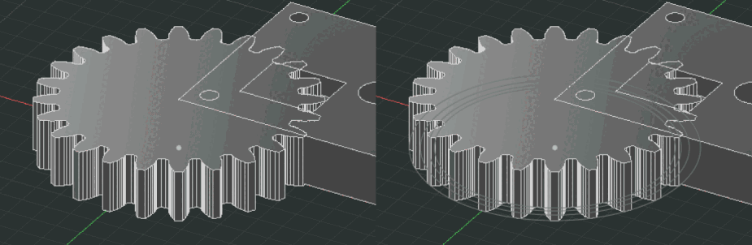
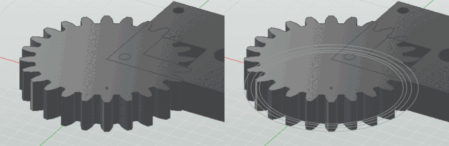
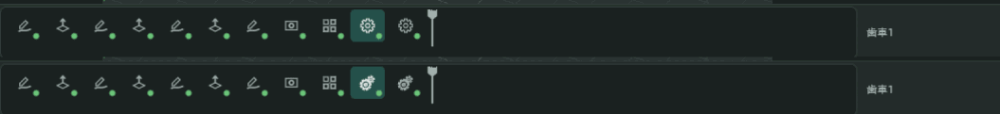
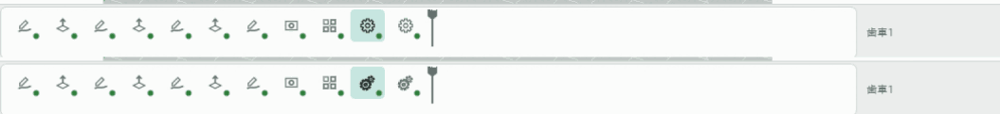

# 歯車の種類の絵と参照の線

- 日付: 2026-11-09

## 作った物

- 種類の一覧の絵: 歯車の輪郭の「種類」の一覧は、名前の前に種類ごとの絵を出す。閉じた一覧の左にも、選んでいる種類の絵を出す。作れない種類は今までどおり一覧に出さない。
- 選択肢の絵の口: 記述子の選択肢(`kmb_core::Choice`)が絵の名前 `icon` を持つ。機能は `Field::choice_icons(&[(値, 絵の名前)])` で書き、画面は名前の絵を描くだけ。編集パネルと設定の窓の選ぶ欄は、絵のある選択肢を絵つきの行で描く。絵の無い欄の見た目は変えない。
- 歯車の種類と絵の対応は `kmb-cad-gear` の `kind_icon` の 1 か所にある。種類を足す時は、ここに 1 行と画面の絵の表(`crates/kmb-ui/src/icons.rs`)に 1 つ足すと一覧に絵が出る。平ベルト車の絵 `mechFlatPulley` を足した。
- 参照の線: 歯車の輪郭かボディを選んでいる間と直している間は、ピッチ円・基礎円・歯先円・歯底円を 3D のビューに薄い参照の線(`kmb_interchange::ink::line::FAINT`)で重ねる。ラックはピッチ線を重ねる。選んでいない歯車には出さない。
- 隠した機能を選んだ時はその重ねる線を出さないが、その機能を直している間は出す。ボディが使うので隠れた歯車の輪郭を直す時に、並べる見当の円が見える。
- 機能の印: 歯車の輪郭と歯車のボディは、タイムラインとブラウザで道具と同じ歯車の絵 `gears` を使う。設定の歯車の絵 `gear` は使わない。

## 決めたこと

- 選択肢の絵は機能の宣言に持たせ、画面に歯車の種類の名前を書かない。
- 作れない種類は灰色で見せず、隠したままにする。灰色にするには欄の型に「選べない」印が要る。種類を作るたびに一覧に出る。
- 参照の線は、選んでいる間と直している間だけ出す。いつも出すと、並べた歯車の線が重なって形が見えにくい。
- 輪郭とボディの機能の印は分けない。どちらも操作「歯車」が一緒に作る物で、タイムラインでは名前で見分ける。
- 選択肢の絵は 20 px・線の太さ 1.4 で描く。18 px では平歯車と鎖車の歯の形が見分けにくい。

## 確かめ方

- `kmb-cad-gear` の試験 `every_kind_choice_names_its_own_picture`: 種類の欄のどの種類にも、互いに違う絵の名前がある。
- `kmb-cad-gear` の試験 `the_reference_circles_are_overlaid_faintly_while_the_gear_is_selected`: 輪郭かボディを選んでいる間だけ 4 つの円が薄い参照の線で重なる。
- `kmb-ui` の試験 `every_choice_picture_is_drawn`: 組み込みの機能が選択肢に書いた絵の名前は、どれも絵の表にあって描ける。
- 台本 `apps/kmb-app/tests/ui/歯車の種類の絵と参照の線.jcs`: 歯車を足し、種類の一覧を開いてラックに替え、OK で決める。

## 画面

種類の一覧(左が前・右が後)

| 暗い画面 | 明るい画面 |
|---|---|
|  |  |

直している歯車のピッチ円などの参照の線(左が前・右が後)

| 暗い画面 | 明るい画面 |
|---|---|
|  |  |

タイムラインの機能の印(上が前・下が後。右の 2 つが歯車の輪郭とボディ)

| 暗い画面 | 明るい画面 |
|---|---|
|  |  |
