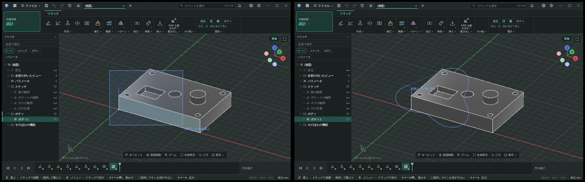
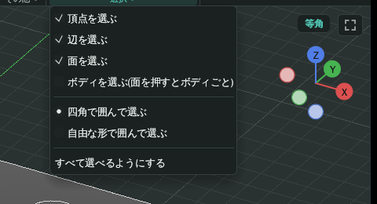
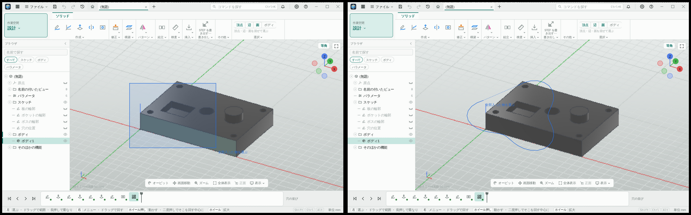
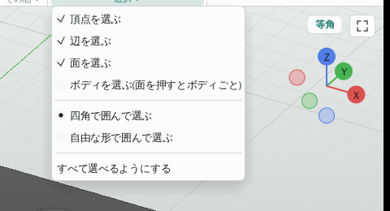

# 自由な形で囲んで選ぶ

- 意図: 細長い物や入り組んだ物を四角の窓で囲むと余計な物まで選ばれ、狙った物だけを選べない。
- 仕分け: B・土台から作る(囲みが四角だけ。選びの判定を領域の型にそろえてから多角形を足す)。
- 日付: 2026-11-09

## 作った物

3D のビューで、左ドラッグでなぞった自由な形で囲んで選べる。

- 選択のメニュー(ツールバー右端の「選択 ▾」と、ビューの Ctrl+右クリック)に「四角で囲んで選ぶ」「自由な形で囲んで選ぶ」を足した。選んだ形は窓全体で持ち、どの文書でも同じ。既定は四角。
- 自由な形の間は、左ドラッグでなぞった道を、離した時に押した所へ閉じて範囲にする。なぞっている間は道を線で、閉じる所を細い破線で描く(塗りは凹んだ形ではみ出すので描かない)。
- 押した所から最初に横へ動いた向きで選び方を決める。右なら全部入った物、左ならかかった物(四角の窓の「右から左へ囲むとかかった物」と同じ覚え方)。色・実線と破線・添える文字も四角の窓と同じ。
- 面・辺・頂点・ボディの選び分け、Shift で足す、作業中の部品の外を除く、は四角の窓と同じ道を通る。

## 決めたこと

- 囲んだ範囲は kmb-ui-view3d の `Area`(四角 `Rect` と多角形 `Polygon`)1 つの型で持ち、内外(`contains`)・線分と三角形にかかるか・全部入るか・折れ線にかかるかをこの型が答える。前は四角だけの関数が view3d に 2 つあり、作業場と 3D スケッチが別々に組み合わせていた。`ViewEvents::boxed` もこの型にした。
- 多角形の内外は偶奇の決まり(なぞった道が自分と交わって 2 重に囲んだ所は外)。縁の上は中に数える。
- なぞった点は前の点から 3 画素以上離れた時だけ足す。点が 3 つ未満か、外形が 6 画素に満たない時は囲まなかったものとする。判定は外形の四角で先に外して、三角形の多い形でも離した時の 1 回で済ませる。
- 3D スケッチの囲み(自分の画面の 3D のビュー)も同じ型を使うが、囲む形は四角のまま(選択のメニューは作業場の物)。
- 始め方は選択のメニューで切り替える形にした(押したまま動かして形を作らない決まりは形を作る操作の物で、選ぶ範囲は四角の窓と同じくドラッグで囲む)。

## 確かめ方

- kmb-ui-view3d の `area` の試験: L 字の内外、8 の字の偶奇、小さすぎる囲み、欠けた所だけを通る線と三角形、中だけ・交差の違い、四角の答えが前と同じ、最初の向きで選び方が替わる。
- kmb-ui の `lasso_tests`: 同じ四角を多角形で囲むと四角の窓と同じ面とボディを選ぶ、角を切った三角形はその一部を選ぶ。`ui_click` の台本で選択のメニューから自由な形に替え、ビューをなぞって全部入った面・かかった面を選び、四角へ戻す。
- 既存の四角の窓の試験(U30 の左右の囲み、部品・動きの画面の囲み)はそのまま通る。

## 画面

kmb-app の `write_lasso_screens`(`JC_SCREENS_OUT` に書く)で撮った。左が前(四角の窓)、右が後(自由な形)。

| 画面 | 前後 | 選択のメニュー |
|---|---|---|
| 暗い |  |  |
| 明るい |  |  |
